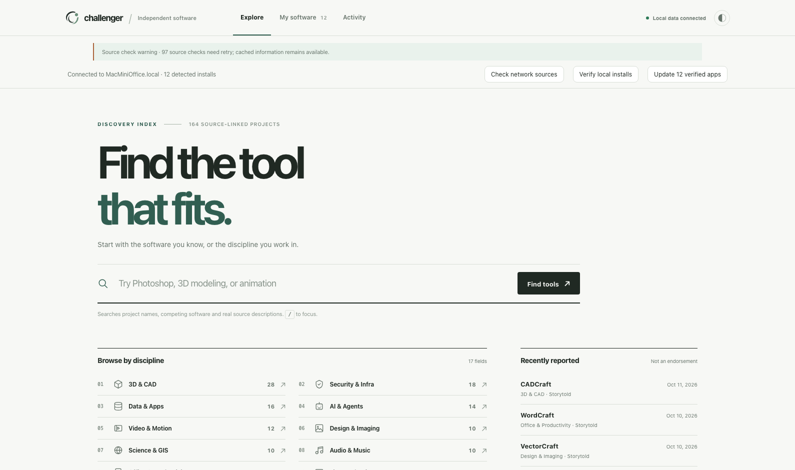

# Focus 4.0 + Orbit — Native Desktop, connected preview 4

This is the first connected native shell of the new Focus design. The window is native WKWebView on macOS and WebView2 on Windows. The backend is the audited Challenger Hub API and source scanner from the existing repository, not the archived read-only mock server. Each package includes Node.js; users need not start a local server or install Node themselves.

The preview binds only to 127.0.0.1:17964 and stores mutable state in a separate preview directory. Nothing is merged into or deployed over Production (127.0.0.1:17873). The working branch is stacked on the design PR and remains Draft.

## Functionality
- Real /api/health, /api/state, local app detection, source signals, queue and history.
- Source scanner with upstream internet requests; optional explicit source check and verify installations.
- UI connects to **the existing approved installation/update workers**. Install/update operations require explicit confirmation and original package validation. Research-only software is blocked. Portable downloads do not install.
- Windows requires UAC elevation for approved installations, not hidden background permissions.
- Focus/Orbit UI retains 17 category icons, 10 official vetted logos and three authentic application screenshots.
- Native window starts the bundled engine and closes its own engine on exit; no permanent new scheduled tasks.

## Limitations — production gate
- **Not all 164 projects are installable.** In particular, 73 research candidates remain unverified. Source tags do not make packages safe.
- Scanner may show cached source information while retrying upstream failures.
- This is **per-computer** management; it does not provide LAN fleet orchestration.
- No potentially destructive actual installer/update was executed as part of QA; passing UI/API tests alone does not establish installation parity.
- The macOS DMG is locally ad-hoc signed, not Apple notarized. Gatekeeper may ask for right-click > Open. Windows needs the Microsoft WebView2 runtime.
- Never replace Production, merge the Draft PR, install unverified applications, or enable unattended deployment before separate approval.

## How to test
macOS: open the Challenger Focus Desktop Preview 4.app from the DMG. Windows: unzip and run ChallengerFocusDesktopPreview4.exe. Neither requires opening a browser or typing an address. The UI connects to the embedded local server on port 17964. In Windows, if an approved install is requested without admin privileges, the interface offers an explicit UAC restart.

## Audit screenshot and source

Source: tools/desktop-build/build-runtime.cjs, live-actions.js, build-mac.cjs, build-windows.cjs and qa-live.cjs. Native hosts derive from the existing platform/windows/Program.cs and platform/macos/main.swift.

The package includes upstream image provenance and separate Node.js license notices. A completed real install on a designated test program remains the outstanding acceptance test before any Production promotion.
