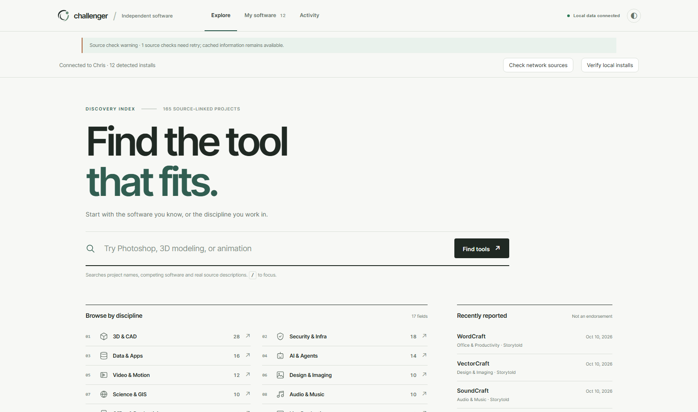

# Challenger Focus + Orbit — Windows Single-EXE Preview 5

This Windows preview repairs the startup failure reported from Preview 4. It is **one distribution file** (ChallengerFocusDesktopPreview5.exe), not a directory-based ZIP. It retains the approved Focus 4.0 design and the original Challenger scanner, installation adapters and local backend. No Production deployment or merge has occurred.

## Confirmed cause and correction

A Preview 4 development process had launched a Node server as Windows SYSTEM (Session 0) on fixed port 17964. The application running under a normal user could not satisfy the old elevation-equality check and attempted to start another backend on the same occupied port. The error incorrectly referred to Start-Center.ps1. The leftover SYSTEM test processes were stopped.

Preview 5 embeds the original vetted backend and its Node binary within the self-contained .NET WinForms/WebView2 EXE. On launch, it extracts 67 verified runtime components to a dedicated per-user Preview5 folder under LocalAppData, then starts its own random loopback port and uses a random private-session token for native health checks and write actions. It does NOT register a Windows service or permanent scheduled task, does not automatically elevate privileges, and does not touch Production. Microsoft WebView2 Evergreen Runtime is still required (available on Chris); no separate Node or .NET installation is needed to RUN the EXE.

## Actual test evidence — 23 October 2026

- 89,467,823 bytes / about 85.3 MiB. SHA256: 0c62e1c913d83656b869a389587d1abc7206e0ab76f00c8785d7ff557bc69429.
- Launched from a folder containing exactly one EXE. Embedded Node + real local API started and returned genuine catalog state.
- Launched as the logged-in account CHRIS\Chris in interactive **Session 1**, without administrative privileges. Its Node child started and reported version 4.0.0-desktop.preview.5 with network enabled. Native WebView2 process started, logged native private session verification and **Desktop UI navigation: True**.
- 35/35 source tests and 10/10 live browser QA scenarios passed, with three real app screenshots, zero JS errors and zero unexpected browser network requests.
- Allowed benign Verify call reached the real backend. Write request without the authenticated session rejected HTTP 403. Unapproved installation request rejected HTTP 400. No real installation, update or deletion was performed.
- SHA256 manifest is pinned inside the EXE; it validates all 67 packaged components, including node.exe and Node's license.
- A temporary interactive QA task was deleted immediately after launch. There are no new permanent Task Scheduler jobs.
- The SYSTEM test process could not initialize a graphical WebView in Session 0 (COM timeout); the actual interactive user launch succeeded.

## Remaining limitations

A completed vetted third-party installation/update is still untested end to end, and upstream release sources may need retries. This version manages the local computer, not a remote fleet. It is an internal pre-release and is NOT Windows Authenticode-signed; Windows SmartScreen warnings are possible. Mac remains on the existing Preview 4 DMG. No merge or Production change is authorized.

Source: tools/desktop-build/build-runtime.cjs (preview 5), build-onefile-windows.cjs, windows-onefile-startup.cs.txt, live-actions.js, qa-onefile-windows.cjs and qa-live.cjs.
