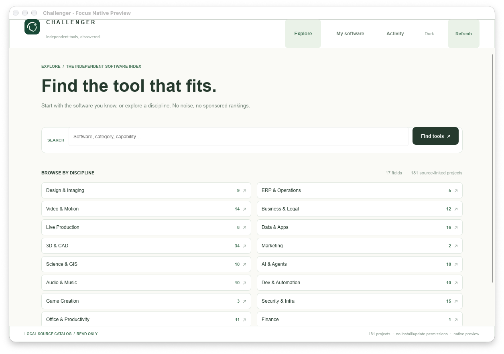
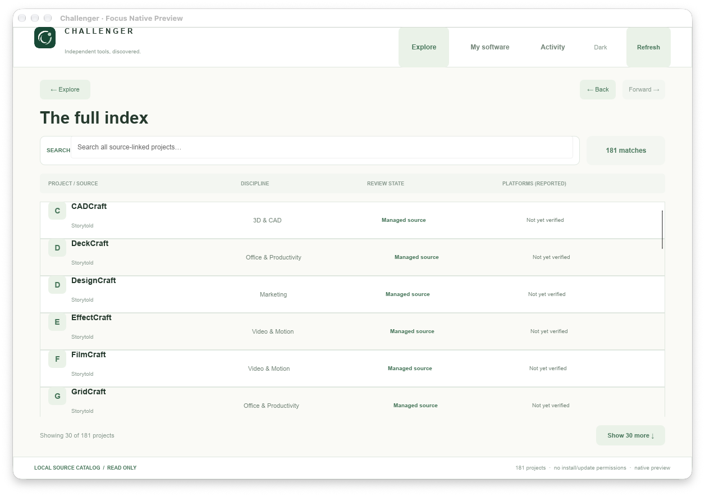
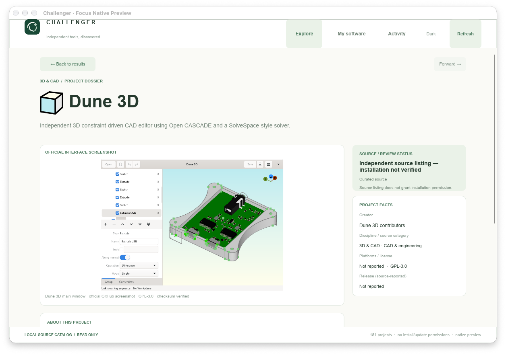

# Challenger Hub — Focus/Orbit Native visual QA

**Real application captures, 24 Oct 2026 · MacMiniOffice2.local · Apple Silicon.** These are screenshots of the running **Slint 1.18.1 / Rust host** over the genuine local Preview12 Node backend. They are not AI mockups, browser pages, or screenshots borrowed from a design file.

The app remains a standalone, read-only developer preview. Nothing was merged or installed into Production. No third-party software was installed or updated.

## Screenshots

### 01. Discover: 17 domains, no permanent sidebar

### 02. Results: compact source index, first 30 items / explicit Show More

### 03. Dune 3D: full-page dossier, approved source icon and real application screenshot

The inner Dune 3D screenshot is independently verified source media, originally from the upstream repository, not generated artwork. Its SHA256, source commit and GPL-3.0 attribution are recorded in [native media provenance](../../../tools/ui-bench/slint-rust-host/ui/MEDIA_PROVENANCE.md). The native QA screenshot was captured from the application's own window using macOS `screencapture -l`; no full-desktop screenshot or unrelated user content was included.

## QA summary

- Rust unit/security tests: **9/9 passed**, including exact source identities, history and 17-domain coverage.
- Mac GUI regression: **PASS**, 181 genuine entries; 17 domains, search, results, dossier, history, Light/Dark, Show More, no-result recovery and both source-pinned media examples.
- Final layout Mac package: **139 MiB**, ad-hoc signed and verified; packaged engine/backend and GUI smoke passed after the screenshot-above-the-fold and empty-search changes.
- Windows/macOS/Linux PR CI tests must be checked against the **latest** commit, not a previous green run. Windows interactive desktop packaging/install QA remains separate from CI's headless acceptance.

Open gaps: live installed/update information and worker timeline, all-source image coverage, keyboard/IME/accessibility/mobile-sized native layout, Windows desktop GUI, full Linux native installer tests, proper Slint attribution/signing/notarization, and actual authorized third-party installation workflows.
