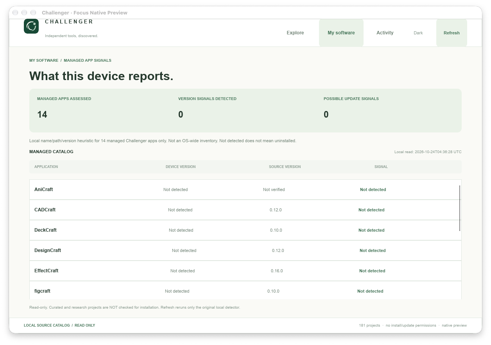
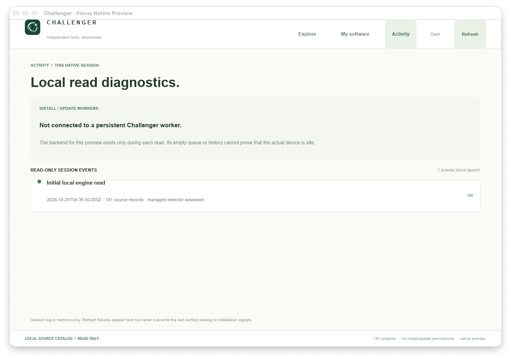
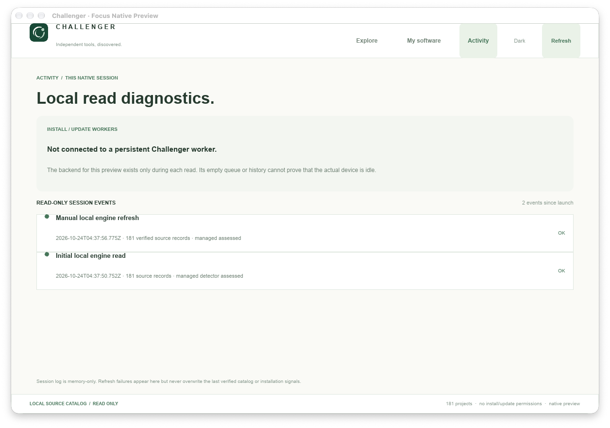
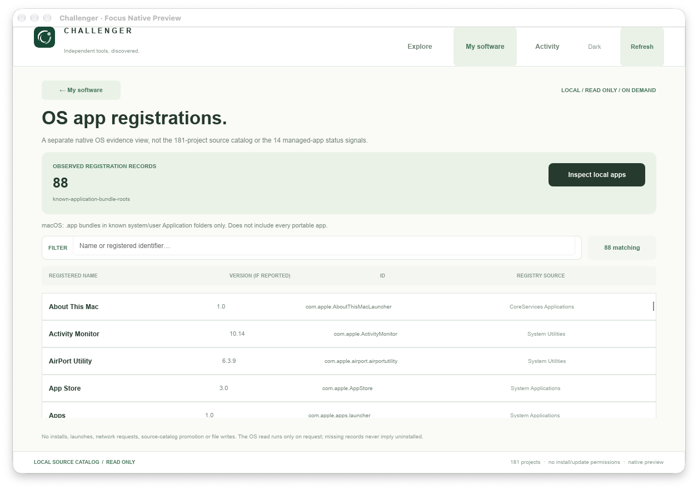

# Challenger Hub — Focus/Orbit Native visual QA

**Real application captures, 24 Oct 2026 · MacMiniOffice2.local · Apple Silicon.** These are screenshots of the running **Slint 1.18.1 / Rust host** over the genuine local Preview12 Node backend. They are not AI mockups, browser pages, or screenshots borrowed from a design file.

The app remains a standalone, read-only developer preview. Nothing was merged or installed into Production. No third-party software was installed or updated.

## Screenshots

### 01. Discover: 17 domains, no permanent sidebar

### 02. Results: compact source index, first 30 items / explicit Show More

### 03. Dune 3D: full-page dossier, approved source icon and real application screenshot

### 04. My software: real managed-app detection, explicitly scoped

The Mac machine's Preview12 built-in local detector assessed the 14 managed Challenger apps and returned zero detected versions. **This does not prove the device has zero applications installed**. Windows and macOS use a non-authoritative name/path/version heuristic; Linux currently reports this inventory source as unsupported. Curated and research projects are never assigned these status signals.

### 05–06. Activity: genuine native-session events, before and after refresh

The second screenshot has two separate actual backend reads, each timestamped and source-validated. No install/update workers were launched, and this in-memory session log is not presented as a persistent worker queue.

### 07. My software → OS app registrations: real on-demand native Rust reader

This is a genuine native Slint window after explicit **Inspect local apps**.
It shows **88 application bundle records** from fixed macOS application roots
on MacMiniOffice2, together with source directory, Info.plist bundle ID and
reported version where available. This is not a certification that 88 apps
are installed/usable; app bundles outside the selected roots are not seen.
The reader is separate from the 14 managed-app signal check. The UI does
not install, launch, remove, auto-match, promote or download any project.
In a separate source-only check on Chris Windows, the fixed read-only
Add/Remove Programs registry query returned **154 registrations** for the
session running the check; Windows Rust + native UI parity still requires
the specific cross-platform CI/interactive tests.

The inner Dune 3D screenshot is independently verified source media, originally from the upstream repository, not generated artwork. Its SHA256, source commit and GPL-3.0 attribution are recorded in [native media provenance](../../../tools/ui-bench/slint-rust-host/ui/MEDIA_PROVENANCE.md). The native QA screenshot was captured from the application's own window using macOS `screencapture -l`; no full-desktop screenshot or unrelated user content was included.

## QA summary

- Rust unit/security tests: **15/15 passed** locally, including native OS registration bounds/identity/sanitization and source scope, managed inventory provenance, stale snapshot rejection, research installation spoof prevention, bounded session events, source identities, history and 17-domain coverage.
- Mac GUI regression: **PASS**, 181 real entries; 17 domains, search, results, dossier, history, Light/Dark, Show More, no-result recovery, both source-pinned media examples, 14 scoped managed-app signals and the native session events. Real manual Refresh was captured after completing a second local backend read. Explicit native OS registration read on macOS: **88 entries**, searchable in the separate My software device view; ordinary app smoke confirms no automatic OS read on navigation.
- Final layout Mac package: **139 MiB**, ad-hoc signed and verified; packaged engine/backend and GUI smoke passed after the screenshot-above-the-fold and empty-search changes.
- Windows/macOS/Linux PR CI tests must be checked against the **latest** commit, not a previous green run. Windows interactive desktop packaging/install QA remains separate from CI's headless acceptance.

Open gaps: exhaustive and authoritative OS package inventory (current OS registration evidence is deliberately bounded and incomplete); matching known software to verified repo IDs; actual persistent worker queue/history (beyond ephemeral session log), all-source image coverage, keyboard/IME/accessibility/mobile-sized native layout, Windows desktop GUI, full Linux native installer tests, proper Slint attribution/signing/notarization and authorized installation workflows.
