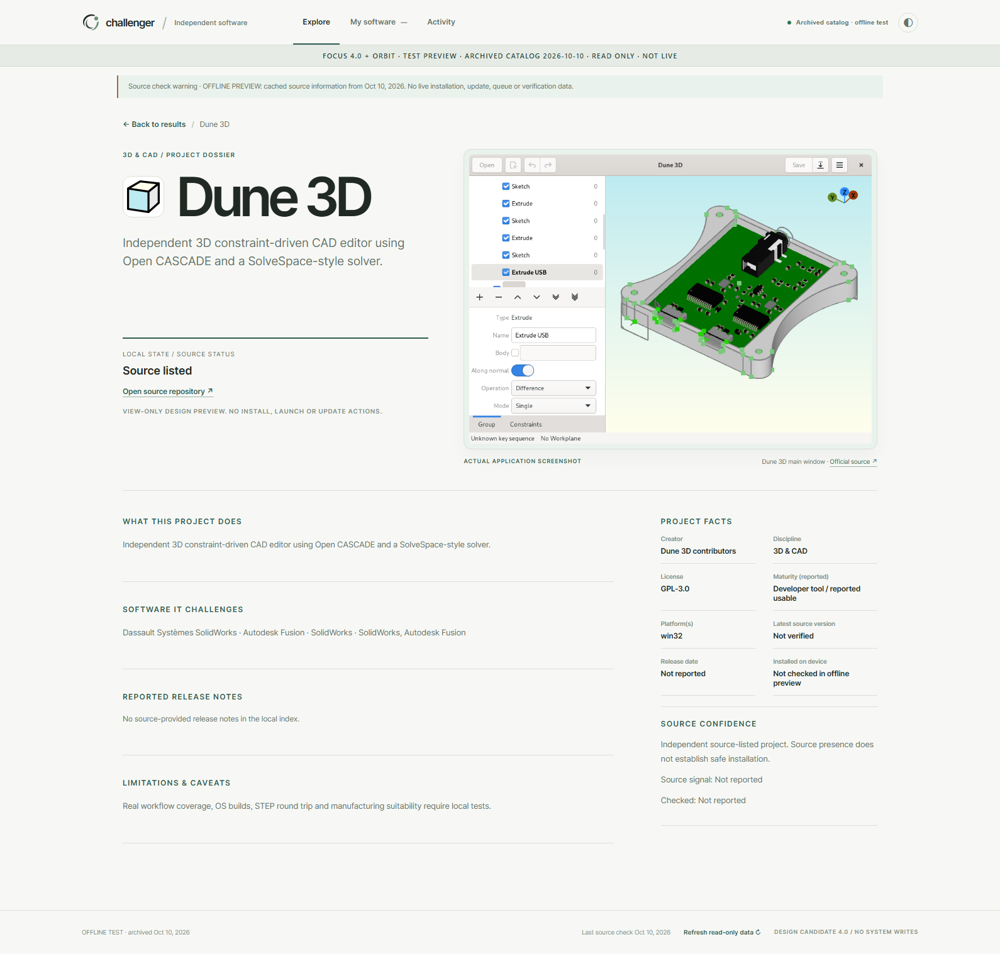
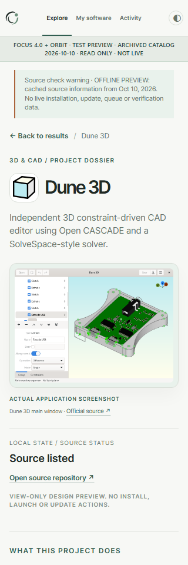
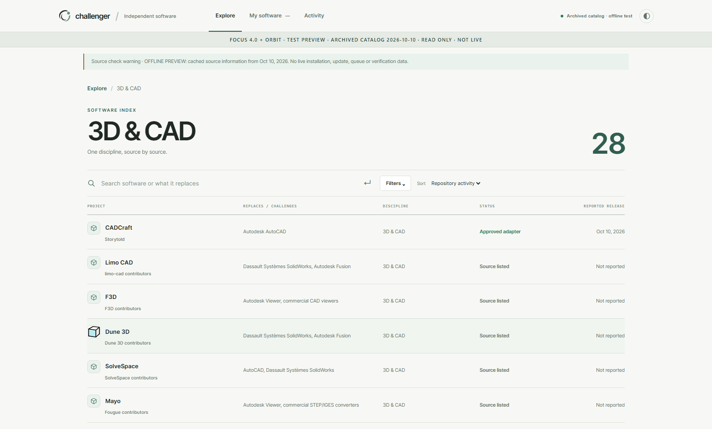
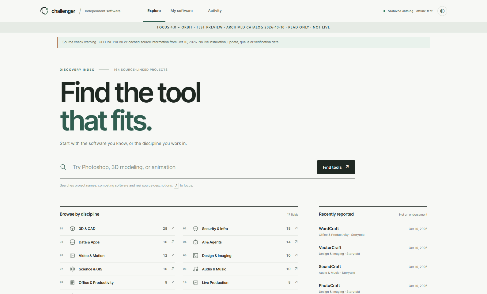
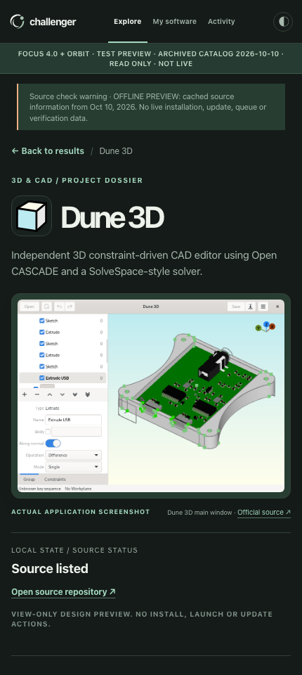

# Challenger Focus 4.0 + Orbit Signature — genuine project media (Preview 2)

This is visual QA from the **running browser against a real, read-only local build**, not an AI mockup.

## Dune 3D real project dossier

## Official-icon rows and quiet Explore

## Provenance and limits

- **The Dune 3D interface screenshot itself is an authentic upstream asset**, taken verbatim from [dune3d/dune3d — screenshot.png](https://github.com/dune3d/dune3d/blob/main/screenshot.png), not a browser capture or generated graphic. The project's [AppStream metadata](https://github.com/dune3d/dune3d/blob/main/org.dune3d.dune3d.metainfo.xml) also identifies its main-window screenshot.
- Screenshot original SHA256: 56f79318ff609044b6e6f3173c77cbb541a09475353f854b667cf99d7bf1c595; 888×639 PNG. License basis: project GPL-3.0; see bundled media notice/license.
- Original icons come from creator-controlled repositories already allowlisted in official-icons.json. Ten icons passed byte and license checks. Four of the first 14 are pending license verification and show discipline fallback. Uncovered catalog entries also show fallbacks; **this is not 164 confirmed icons**.
- Runtime only loads local bundled media on loopback. No third-party hotlinks, background network, installations, scanners, writes, fake reviews, or live installed counts.
- Content remains the archival catalog of October 10, 2026. The 73 restricted research candidates remain restricted.
- **No Production changes or PR merges**.

## QA evidence

Windows Chris: 10 responsive/theme scenarios PASS (1590, 1040, 768, 430, 320 × light/dark); 17 category icons, 28 entries in the 3D & CAD category, Dune 3D genuine screenshot, zero browser JavaScript errors, zero non-GET requests, and HTTP 405 for attempted mutations. Machine-generated report: preview build's _qa/browser-qa-media-v2.json.

macOS MacMiniOffice: 10 responsive/theme scenarios PASS (same 5 widths × 2 themes); real Dune 3D screenshot and upstream icon loaded, zero JS errors, zero writes and zero external image requests. Full report in the macOS preview folder: `_qa/browser-qa-media-v2.json`.

Both hosts passed the five Node regression tests. No Production changes, no PR merges.
