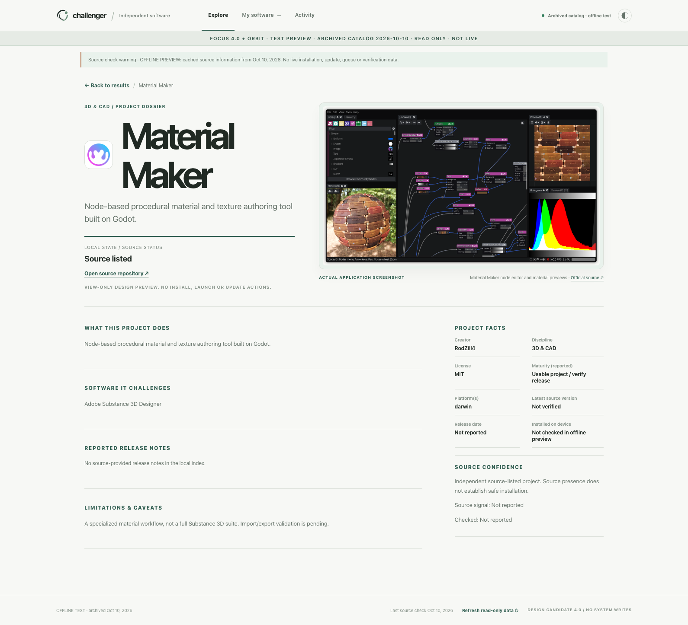
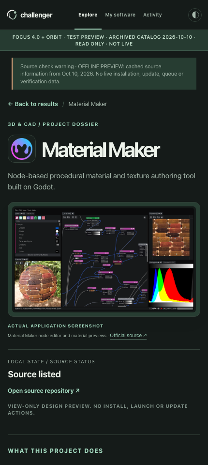
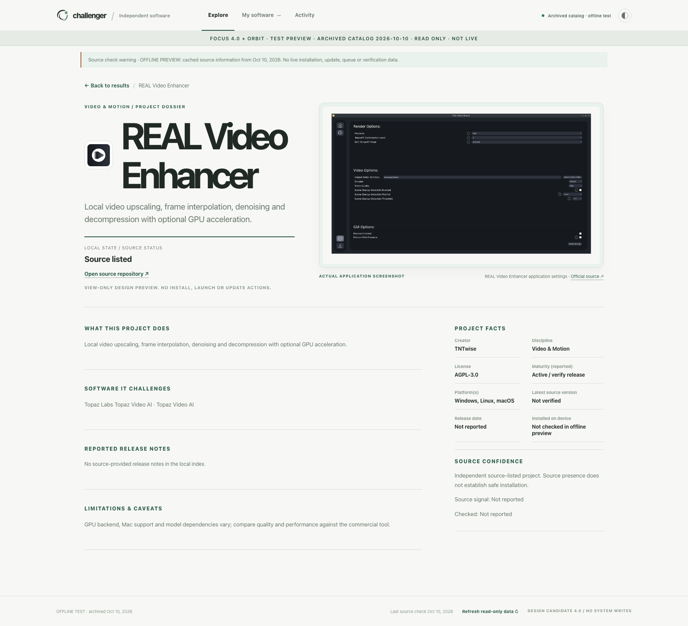
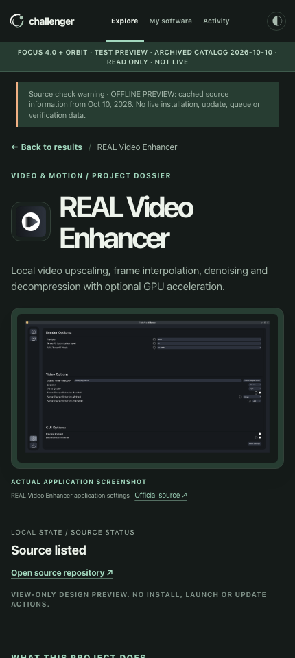
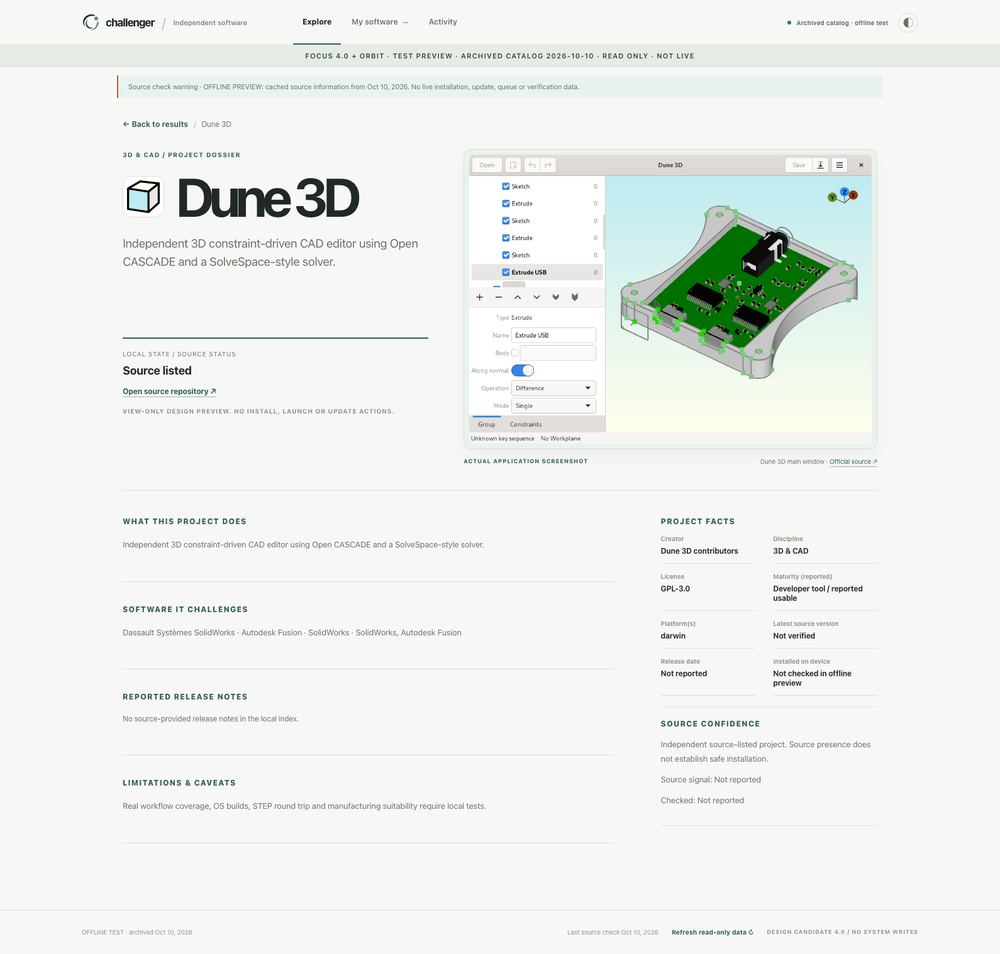
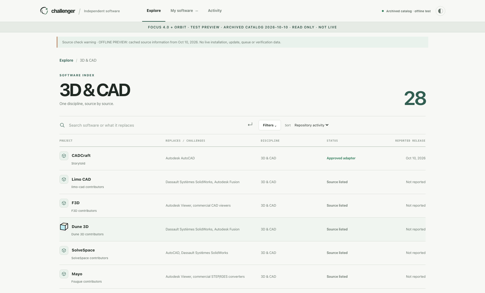

# Challenger Focus 4.0 + Orbit — Preview 3: verified real application screenshots

The images below are **actual browser QA captures from the MacMiniOffice machine rendering the code**, not AI mockups. Each featured project shows an image published and controlled by the upstream developer; full source URLs, pinned upstream commits, byte SHA256 digests, repository licensing notes and origin acknowledgments are in the checked-in project-media.v1.json and THIRD_PARTY_MEDIA_NOTICES.md.

**Preview 3 is NOT LIVE**: the October 10, 2026 local archive contains 164 catalog entries, including 73 restricted unverified install candidates. No production installations, jobs or updaters are connected.

## Material Maker — verified source screenshot from official README

The original 1920×1105 PNG is from the [Material Maker developer's source repository](https://github.com/RodZill4/material-maker/blob/424dec64a75478f22267ba9281a5cbe7a236b802/material_maker/doc/images/screenshot.png), explicitly embedded in its [official README](https://github.com/RodZill4/material-maker/blob/424dec64a75478f22267ba9281a5cbe7a236b802/README.md). SHA256: 82914343db0a3af22f5b96f7b42e362f58f93f9c499b3fad48d182d9059e4f7c. Repository license: MIT (local license copy included).

## REAL Video Enhancer — verified settings interface

Original developer-repository [application settings screenshot](https://github.com/TNTwise/REAL-Video-Enhancer/blob/8541c46ca14e6f84fc86c5b9d3b75373e25732e5/screenshots/settings.png), 2050×1166 PNG. SHA256: c7ef740510585be4f19573e348595216f5d407328424c2b0faba532e654acd6b. The demo.png screenshot contains a separate anime video frame; it was not bundled. Repository license: AGPL-3.0 (local copy included). Caption identifies a settings interface, not a processing result.

## Dune 3D — original project screenshot retained

Upstream [main-window screenshot](https://github.com/dune3d/dune3d/blob/d01faaf16f309e55834c3b93dddce5c852453cfe/screenshot.png) referenced by the project's [AppStream metadata](https://github.com/dune3d/dune3d/blob/d01faaf16f309e55834c3b93dddce5c852453cfe/org.dune3d.dune3d.metainfo.xml). Original PNG SHA256: 56f79318ff609044b6e6f3173c77cbb541a09475353f854b667cf99d7bf1c595. License basis GPL-3.0 repository, original license copied.

## Search rows and graceful fallbacks

- Icon assets: 10 official source-linked and license-reviewed, of the 14-item starting pilot. Other projects display subtle discipline fallback, not guessed logos.
- Authentic project screenshot coverage: **3 of 164** archived projects. No screenshot is invented or substituted for missing projects.
- Responsive real browser QA: 1590, 1040, 768, 430, 320 × Light/Dark on Windows Chris and MacMiniOffice, with all three dossier images loaded and 0 JavaScript errors, 0 external requests, 0 browser writes, and read-only 405 method checks.
- Development lives in a Draft PR, Preview 3 in a separate GitHub Pre-release. Nothing merged or deployed to Production.
