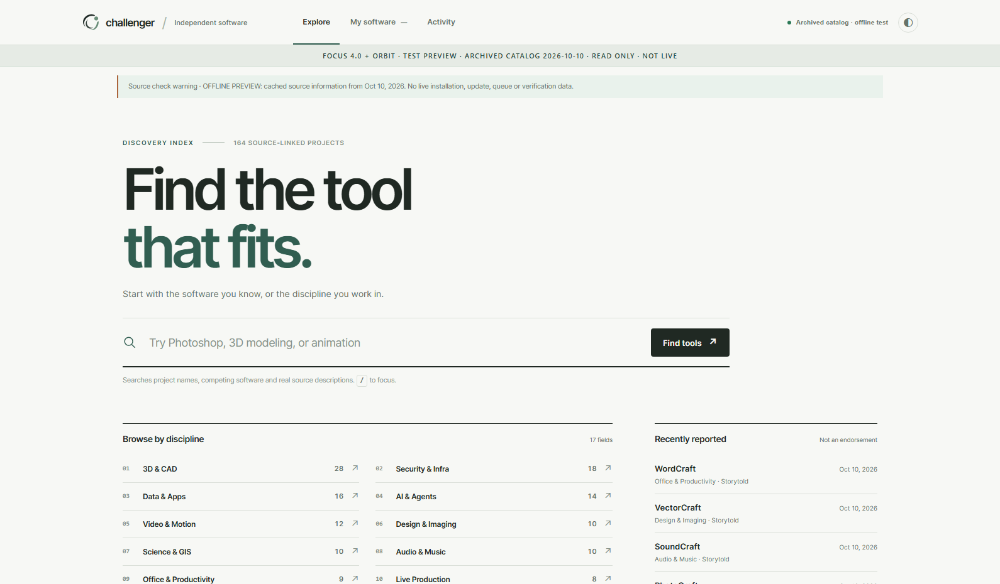
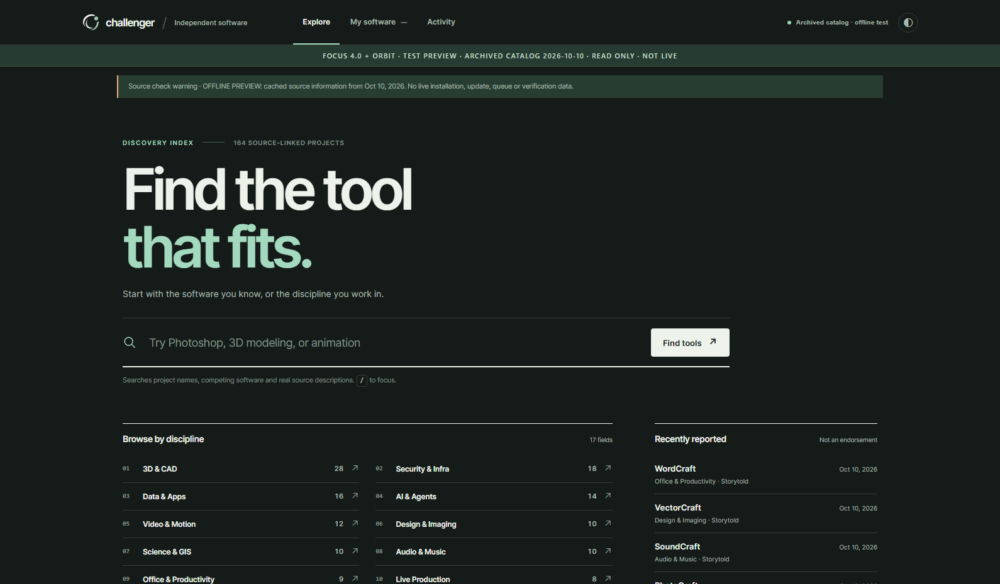
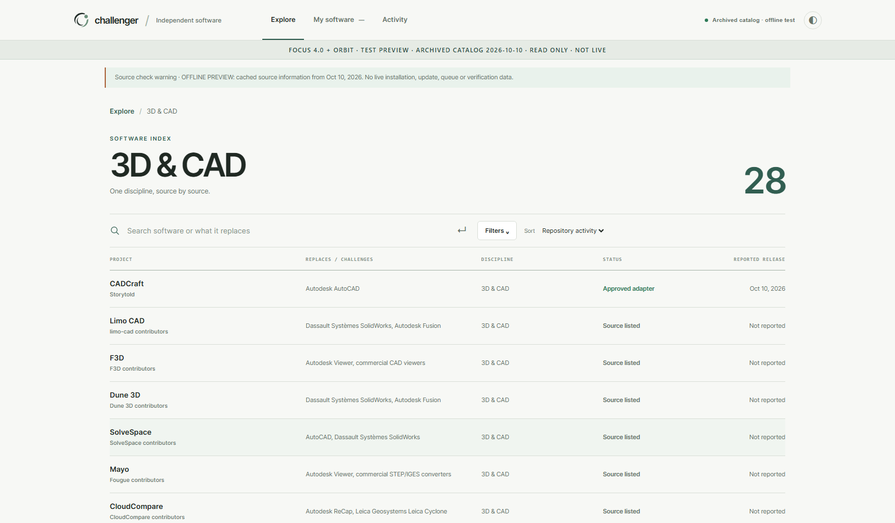
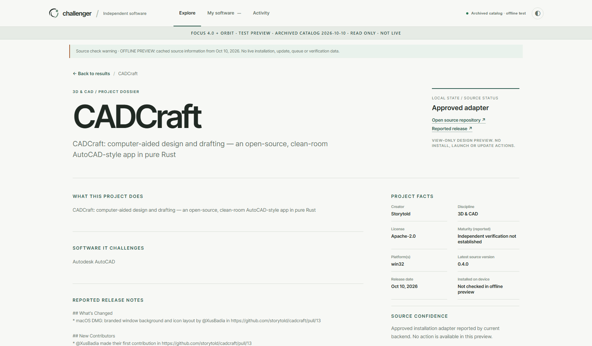
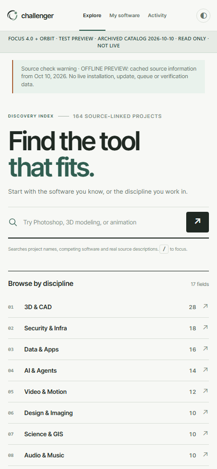
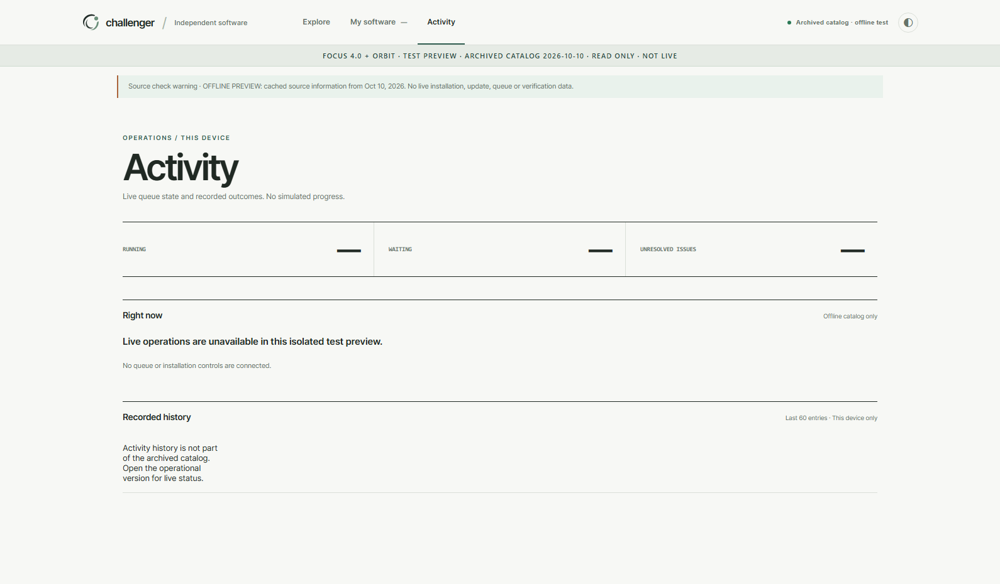

# Focus 4.0 + Orbit Signature · Offline Test Preview 1

**Real browser screenshots, not AI mockups.** Captured from the runnable local test preview on Windows Chris, using a sanitized archive of the actual project's cached discovery index (164 projects; archive checked 2026-10-10). **Not live production**. No installation, source scan, app launch or updates are enabled.

## 1 — Discovery — light

[Open original image](https://github.com/nocturney/challenger-hub/blob/test/focus-orbit-preview-1/docs/previews/focus-orbit-test-v1/01-discover-light.png?raw=1)

## 2 — Discovery — dark

[Open original image](https://github.com/nocturney/challenger-hub/blob/test/focus-orbit-preview-1/docs/previews/focus-orbit-test-v1/02-discover-dark.png?raw=1)

## 3 — 3D & CAD results

[Open original image](https://github.com/nocturney/challenger-hub/blob/test/focus-orbit-preview-1/docs/previews/focus-orbit-test-v1/03-results-3d.png?raw=1)

## 4 — Source dossier

[Open original image](https://github.com/nocturney/challenger-hub/blob/test/focus-orbit-preview-1/docs/previews/focus-orbit-test-v1/04-project-dossier.png?raw=1)

## 5 — Narrow mobile layout

[Open original image](https://github.com/nocturney/challenger-hub/blob/test/focus-orbit-preview-1/docs/previews/focus-orbit-test-v1/05-discover-mobile.png?raw=1)

## 6 — Activity correctly marked unavailable

[Open original image](https://github.com/nocturney/challenger-hub/blob/test/focus-orbit-preview-1/docs/previews/focus-orbit-test-v1/06-activity-offline.png?raw=1)

Build instructions: [test preview readme](../../../tools/preview-build/README.md).

**Release boundary:** this is a stand-alone local test at port 17961 with archived offline data. The installed and pending updates statuses are deliberately unavailable. Production remains separate and untouched.
