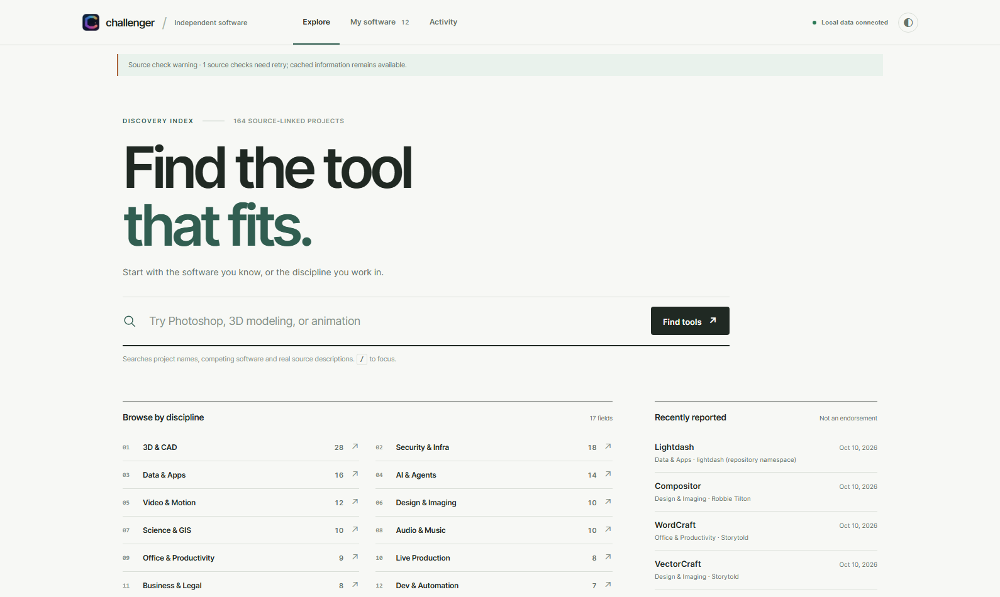
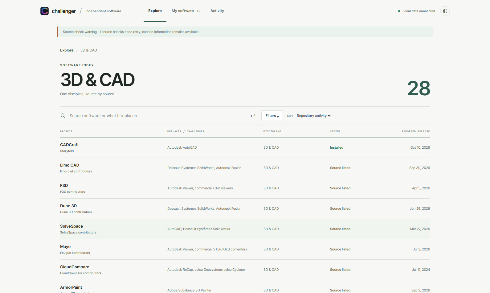
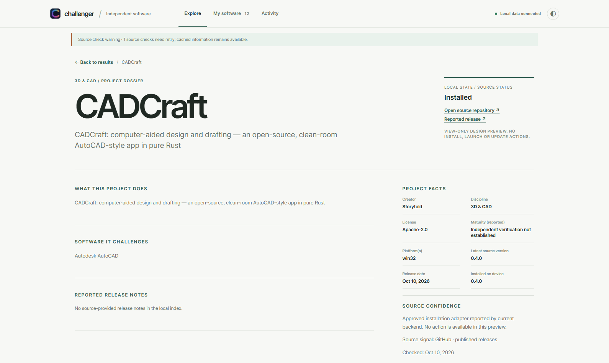
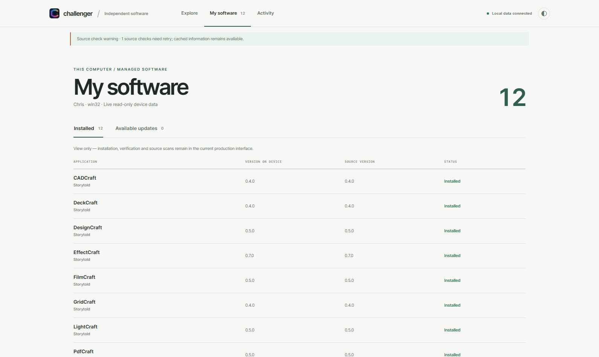
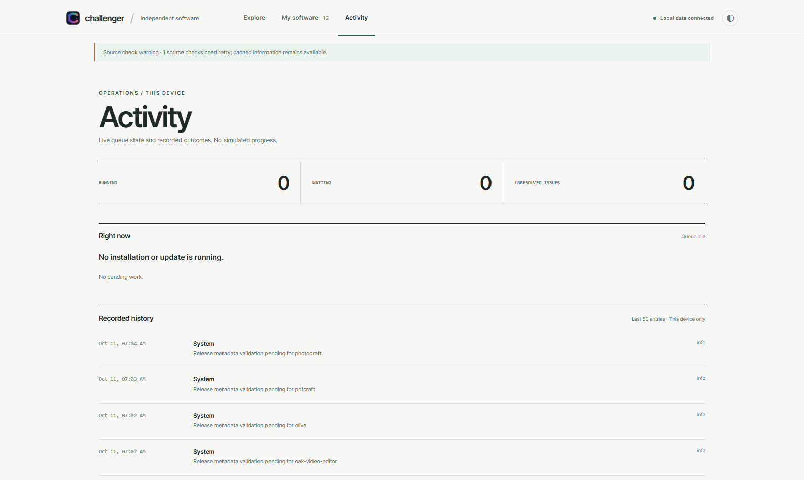
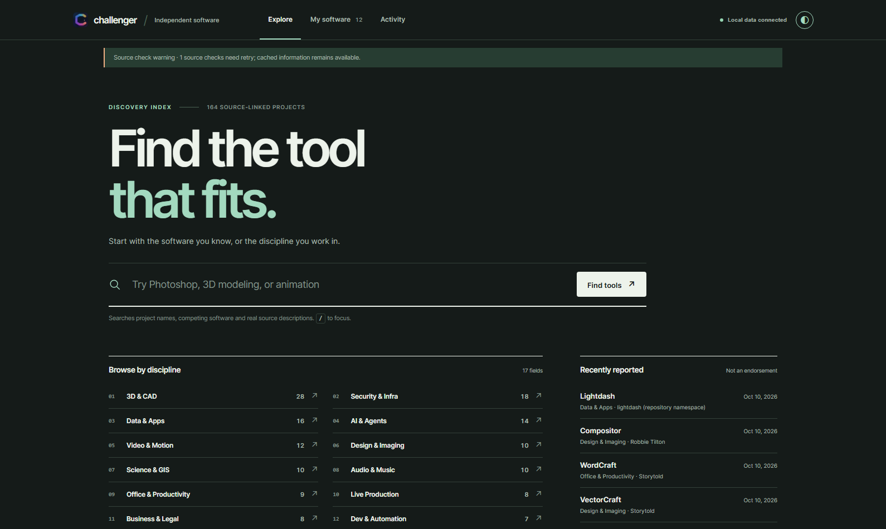
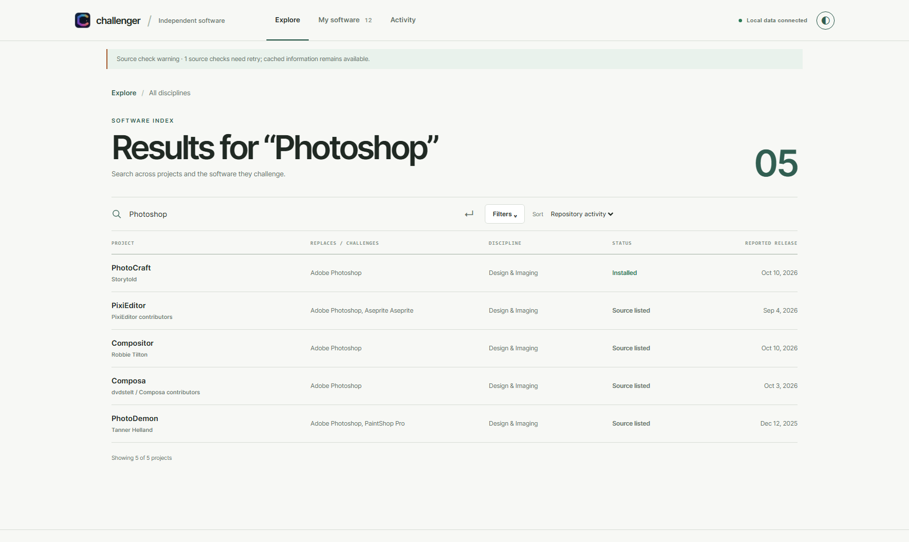
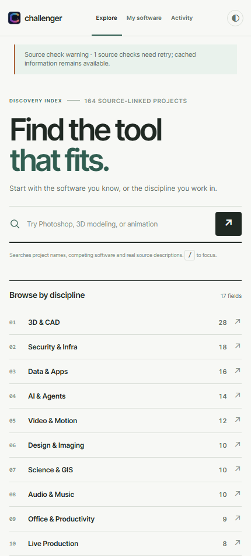
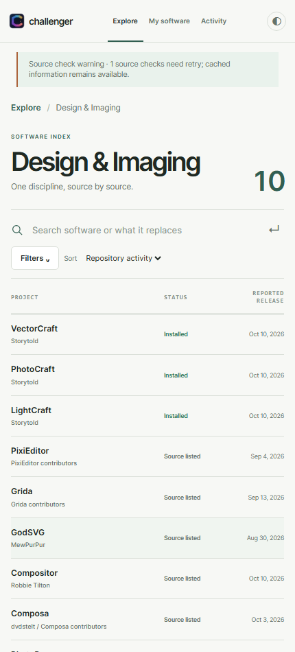
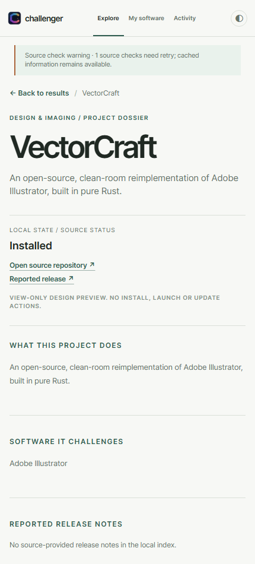

# Challenger Focus 4.0 — a genuinely different information architecture

**Read-only, task-first design concept. Not a release.** These ten screenshots come from the actual Windows Chris local staging interface, with the live 164-project index loaded through its read-only API. No synthetic item names, counts or screenshots. Dates and statuses are snapshot-specific.

## Why this is structurally different

Previous candidates kept a single crowded dashboard with a hero, category navigation and the catalog always in view. Focus changes **where content exists, when it appears, and how a user reaches a decision**:

| Prior dashboard variants | Focus 4.0 |
| --- | --- |
| Global left navigation rail | Three top-level destinations, no rail |
| Hero, categories, cards, inspector all coexist | Dedicated discovery screen: no result list until the user searches or chooses a field |
| Software presented as a card grid | Search/browse results displayed as an actual comparison table |
| Inspector floats inside the catalog | Selecting a project opens a full project dossier as its own page |
| Installed and Updates are separate global destinations | Updates is one tab within My software, not a competing navigation route |
| Repeated category shortcuts and redundant queue controls | One category index; Activity has exactly one top-level destination |
| Lots of attention-grabbing gradients and decoration | Restrained typography and whitespace; content is the interface |

## 1 — Begin with the actual intention

The first screen asks what a user is looking for, rather than showing everything at once. Search directly supports **familiar commercial software**, independent project names and actual descriptions. Choosing a discipline is a second, equivalent route, not a duplicate global nav destination.

## 2 — Compare only relevant results

After selecting 3D & CAD, the user sees a **full list of the 28 matches**, including real alternatives, availability and source-reported dates. Further filtering is optional, not a second permanent strip.

## 3 — Read one project fully

Selecting a result leaves the index and opens a **dedicated page** with the source-provided description, the familiar application being challenged, current local status, reported release, safety caveats, repository link and project facts. No install controls are fabricated into the prototype.

## 4 — One local workspace, including updates

**My software** includes Installed and Available updates within the same surface. Both use actual local state, and never imply that the other host has the same installed versions or update status.

## 5 — Operations, not decorative counters

**Activity** is a timeline of actual job history and queue state. It does not show simulated progress or ungrounded success claims.

## Light and dark, without a new gimmick

## A real search workflow

## Deliberate phone layout

## Compare to the previous approaches

- [Observatory 3.0 — conventional dashboard](../observatory-3.0.0/discover-dark-desktop.png)
- [Signal Field 3.1 — typographic editorial poster](https://github.com/nocturney/challenger-hub/blob/feat/signal-field-v3.1-design/docs/previews/signal-field-3.1.0/README.md)
- [Nexus 3.2 — constellation / research map](https://github.com/nocturney/challenger-hub/blob/feat/nexus-v3.2-network/docs/previews/nexus-3.2.0/README.md)

**Live read-only preview on each device separately:** http://127.0.0.1:17951/

## What this prototype is not

It is not a fully operational replacement for the production app: installer confirmation, launches, scans, package verification, stored settings and platform-native interactions intentionally remain in the older production implementation. This is a proof of the **new information architecture**. It does not have legacy feature parity and **must not be merged or deployed as production**.

**Please judge the sequence:** Find a tool → compare matches → open a full dossier; My software → installed/updates; Activity → real operations. Is this fundamentally more understandable and professional than the previous single-page dashboards?
