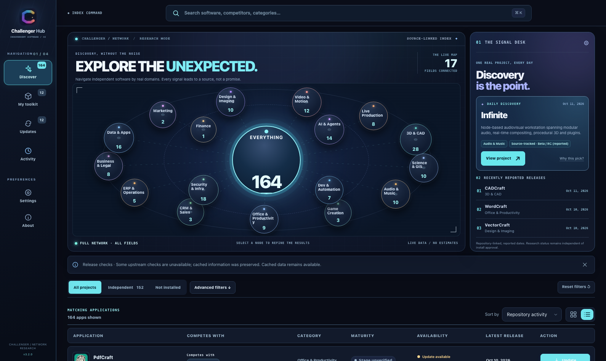
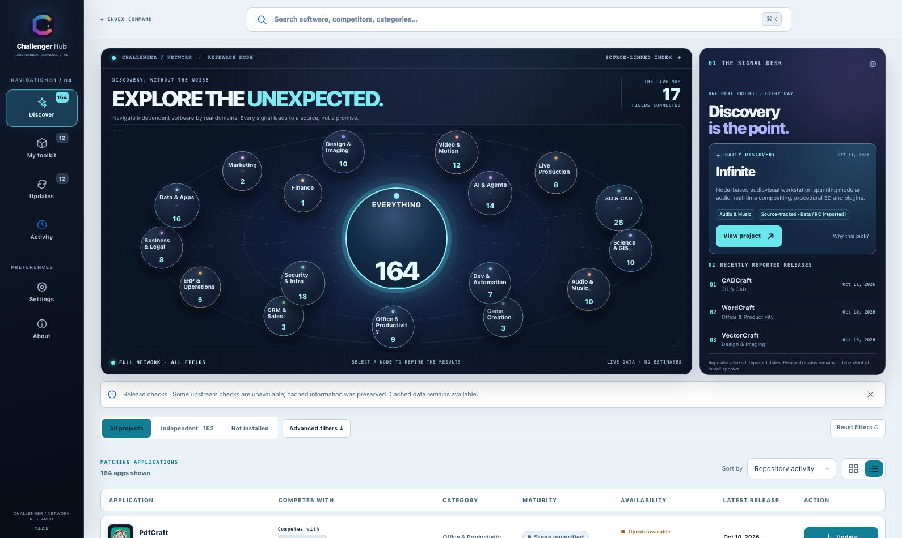
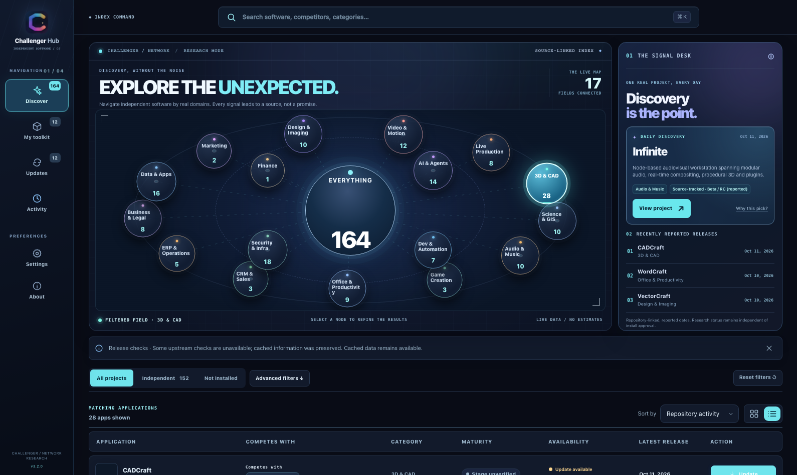
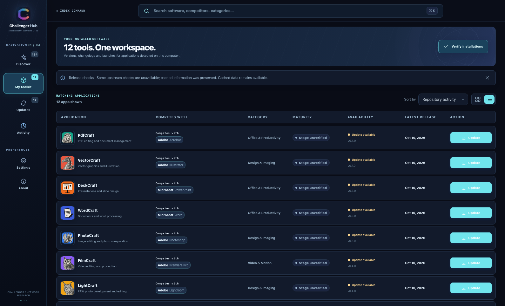
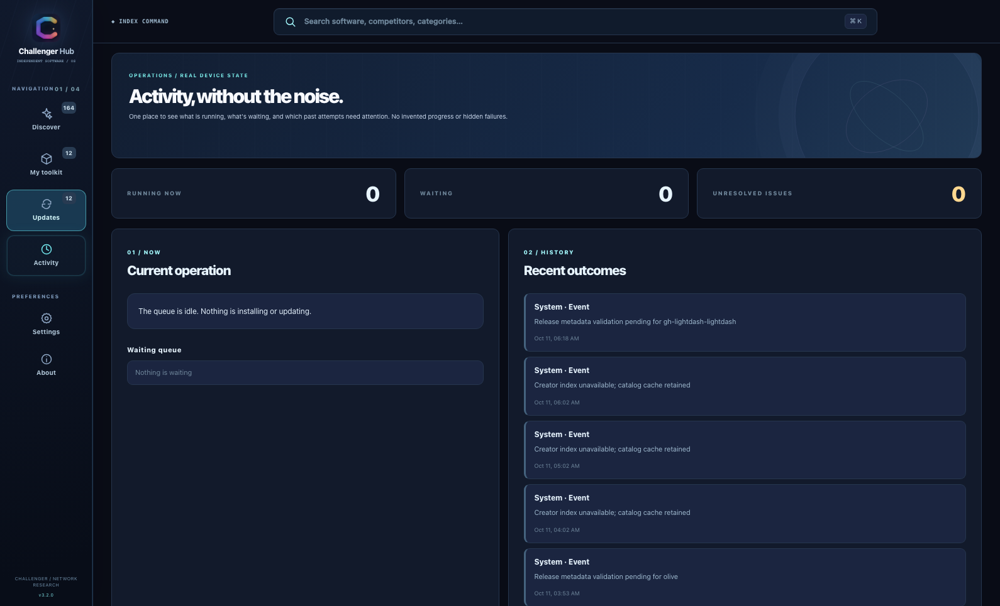
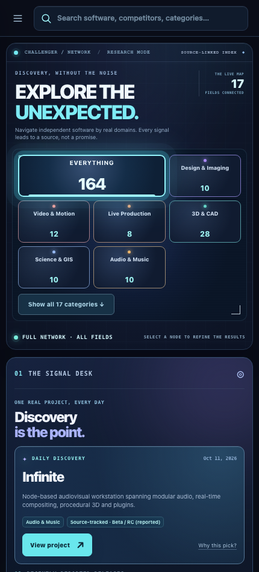
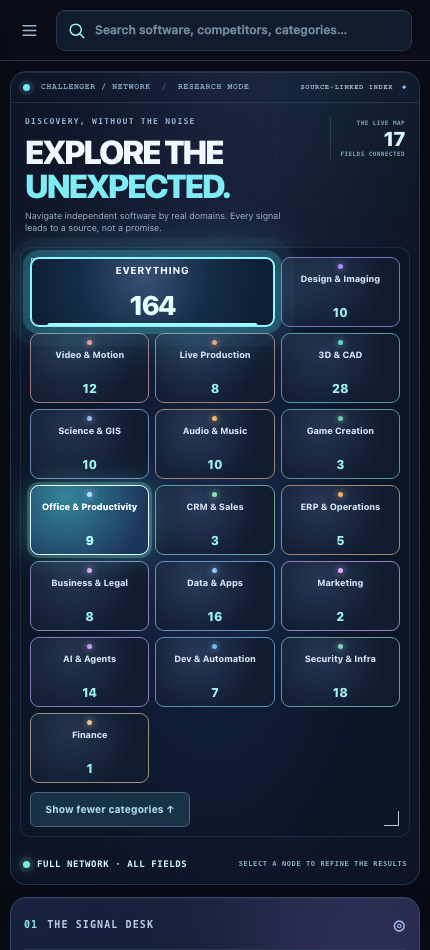

# Nexus 3.2 — spatial discovery as a working instrument

**Third independent design candidate. Not a deployed release.** Captured from the real, read-only Challenger Hub staging preview on MacMiniOffice.local, October 11, 2026. These are genuine browser screenshots with the catalog loaded from the Mac's production read API, not illustrations or synthetic datasets. The snapshot numbers can change with the upstream index.

## Three fundamentally different directions

**Observatory 3.0** — the cleaner, traditional dashboard:

**Signal Field 3.1** — the editorial poster / print-inspired index:

[View Signal Field 3.1's screenshots in the separate, unchanged draft branch](https://github.com/nocturney/challenger-hub/blob/feat/signal-field-v3.1-design/docs/previews/signal-field-3.1.0/README.md)

**Nexus 3.2** — a spatial research instrument. There is no promotional hero, featured visual product ranking, or extra shortcut navigation. The network itself is the entry point:

## A different light, the same real graph

## Every node leads somewhere real

The 17 orbiting nodes represent **actual category counts** drawn from the source-linked 164-project catalog. Selecting *3D & CAD* filters the software list to the 28 projects in that discipline in this captured session. The central Everything node restores the full domain set; it is a filter control, not a second navigation menu.

## The live professional workspaces

The compact navigation continues into My toolkit, Updates and a single Activity page. It does not reopen multiple versions of the installation queue.

## Mobile is not just a shrunken desktop map

The network becomes an accessible field matrix. The **Show all 17 categories** action makes every field available, not just the first six.

## Live interaction (read-only)

From the actual device:

- **MacMiniOffice.local:** [Nexus staging on port 17950](http://127.0.0.1:17950/) — live Mac device data, GET/HEAD only.
- **Chris (Windows):** [Nexus staging on port 17950](http://127.0.0.1:17950/) — live Windows device data. Its backend had a transient outage during initial QA but recovered without a restart; the final ten-width Windows browser QA passed.
- **Observatory 3.0:** [earlier local preview](http://127.0.0.1:17948/).
- **Signal Field 3.1:** [other local preview](http://127.0.0.1:17949/).

The source warning remains visible where upstream checks are unavailable. No installed software was changed or launched for these captures. **A design review is required before any merge or production deployment.**
