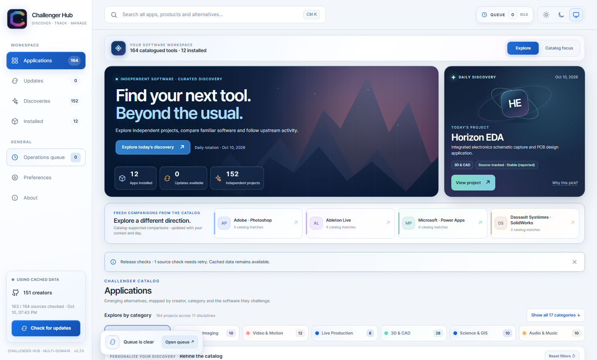
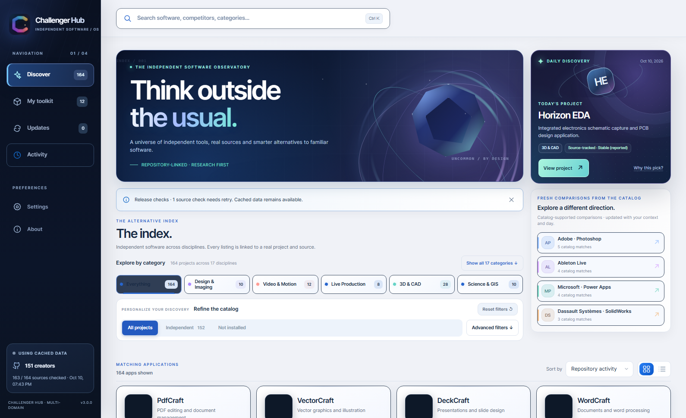
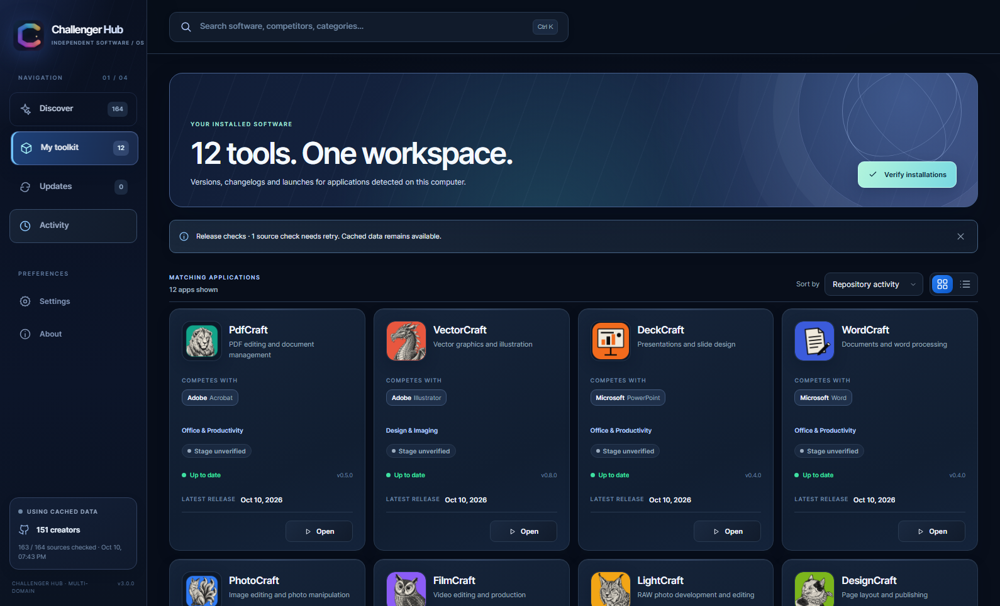
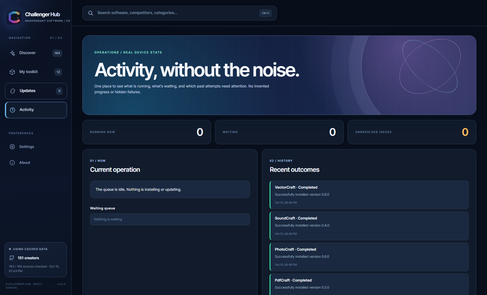
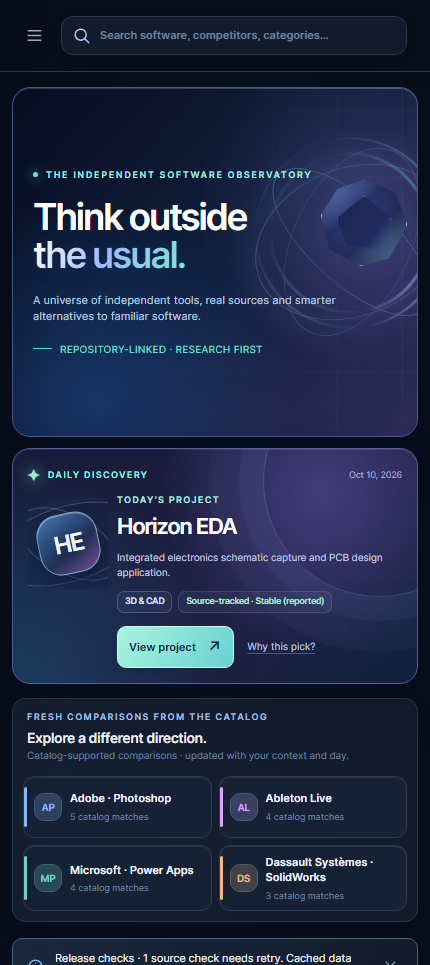

# Observatory 3.0.0 — visual QA gallery

Images captured from live-data, read-only Chromium staging on the Windows Chris host, October 10, 2026. These are design snapshots, not immutable runtime facts. No install or update operations were executed.

## Before: 2.7.0, Explore in light theme

## After: 3.0.0, Discover in dark theme

## After: 3.0.0, Discover in light theme

## After: 3.0.0, My toolkit

## After: 3.0.0, Activity — one full-screen operational destination

## After: 3.0.0, mobile (430px)

The application itself remains interactive in the local read-only preview at http://127.0.0.1:17948 on each host. Production remains 2.7.0 until separately authorized.
