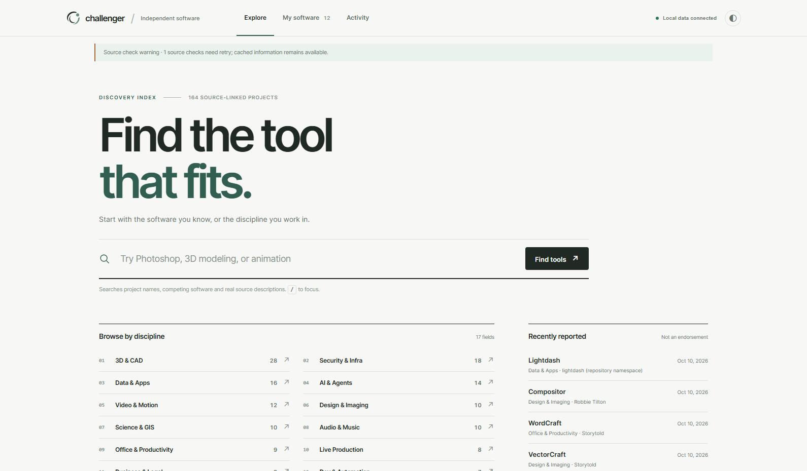
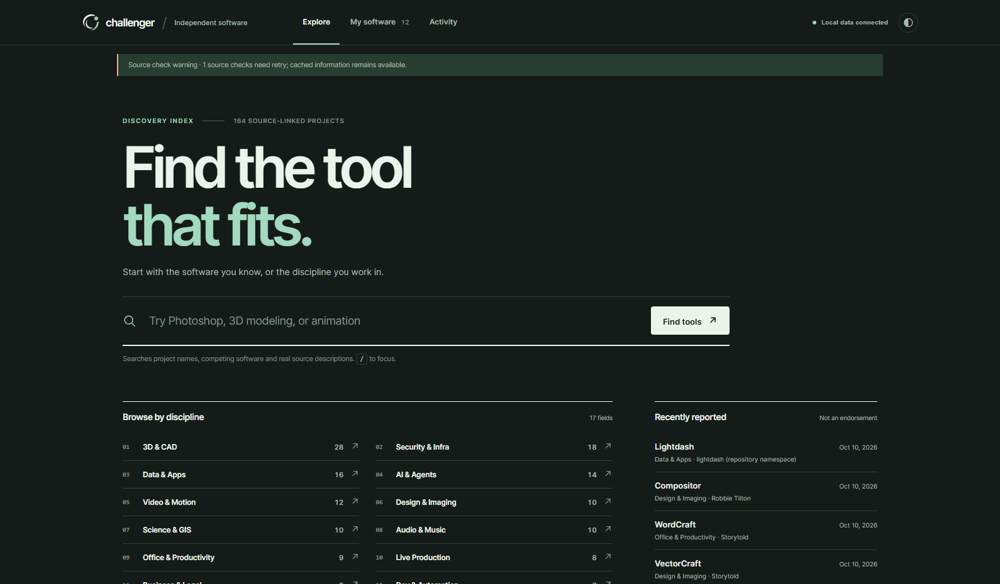
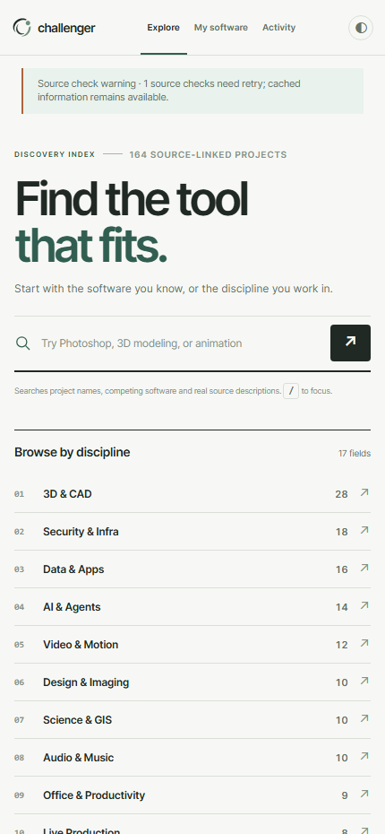
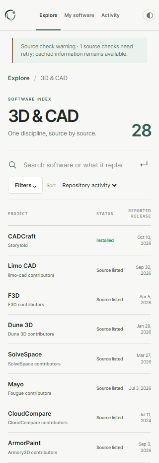
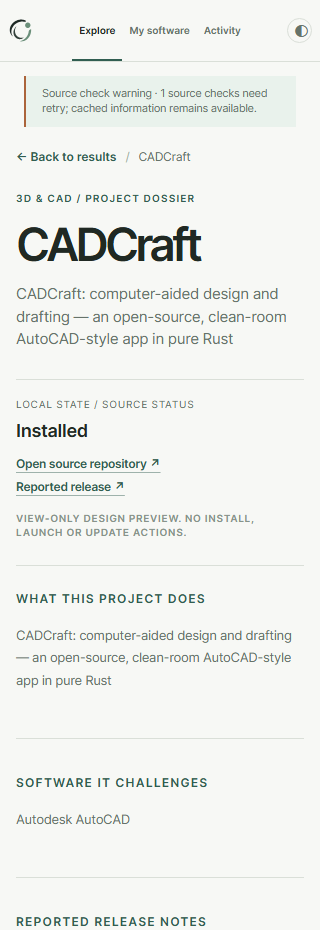
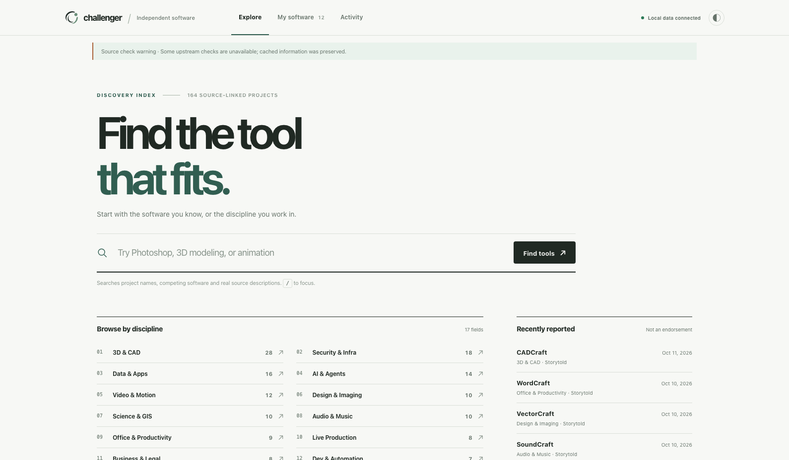
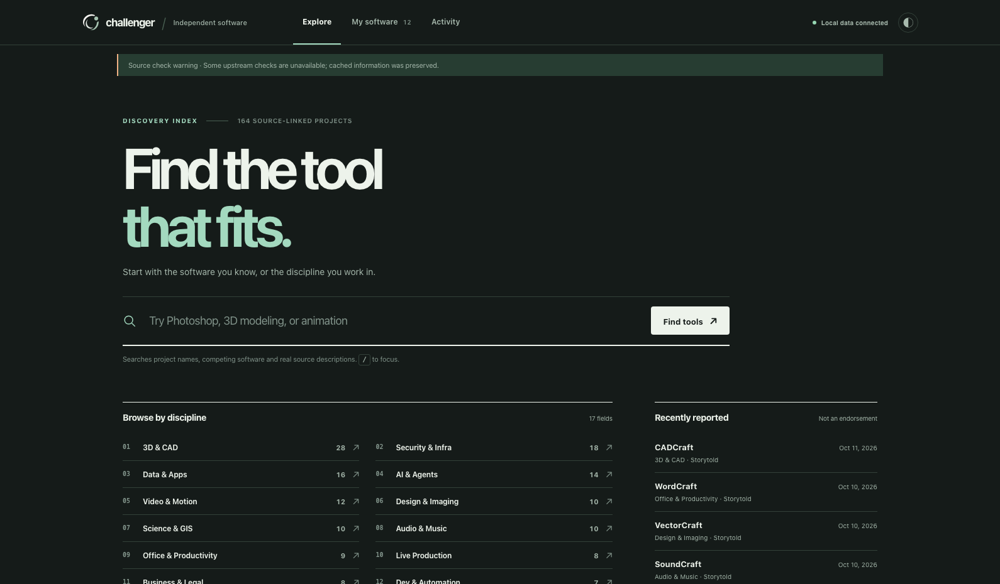
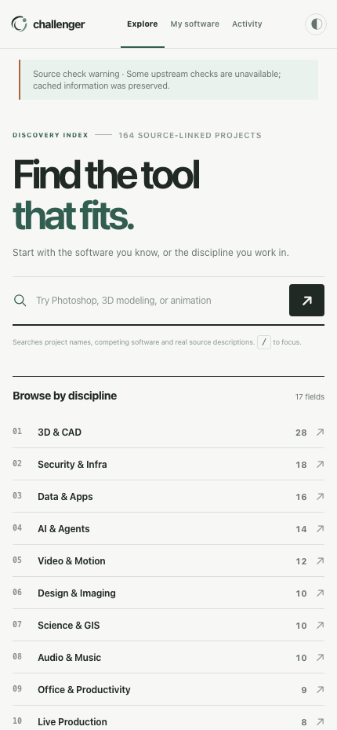

# Orbit Signature v1.0 — actual Focus 4.0 integration

**Brand design candidate / not production.** All screenshots are real read-only live-data browser captures from Windows Chris or MacMiniOffice.local. The source status is device-specific and may be stale.

The approved Orbit Signature has been reconstructed from the previously approved rendered board into editable SVG paths. It is a traced reproduction, NOT the unavailable original editable native logo file. The app keeps the Focus 4.0 architecture unchanged: flat graphite/sage icon on light UI, off-white/sage on dark UI, and a forest-green app icon for favicon and launcher. No purple/blue glow, no new slogan.

## Windows and Mac browser evidence

### 01 — win focus light desktop

[Open original PNG](https://github.com/nocturney/challenger-hub/blob/feat/orbit-signature-brand-v1/docs/previews/orbit-signature-v1/win-focus-light-desktop.png?raw=1)

### 02 — win focus dark desktop

[Open original PNG](https://github.com/nocturney/challenger-hub/blob/feat/orbit-signature-brand-v1/docs/previews/orbit-signature-v1/win-focus-dark-desktop.png?raw=1)

### 03 — win focus mobile

[Open original PNG](https://github.com/nocturney/challenger-hub/blob/feat/orbit-signature-brand-v1/docs/previews/orbit-signature-v1/win-focus-mobile.png?raw=1)

### 04 — win results 3d

[Open original PNG](https://github.com/nocturney/challenger-hub/blob/feat/orbit-signature-brand-v1/docs/previews/orbit-signature-v1/win-results-3d.png?raw=1)

### 05 — win project dossier

[Open original PNG](https://github.com/nocturney/challenger-hub/blob/feat/orbit-signature-brand-v1/docs/previews/orbit-signature-v1/win-project-dossier.png?raw=1)

### 06 — mac focus light desktop

[Open original PNG](https://github.com/nocturney/challenger-hub/blob/feat/orbit-signature-brand-v1/docs/previews/orbit-signature-v1/mac-focus-light-desktop.png?raw=1)

### 07 — mac focus dark desktop

[Open original PNG](https://github.com/nocturney/challenger-hub/blob/feat/orbit-signature-brand-v1/docs/previews/orbit-signature-v1/mac-focus-dark-desktop.png?raw=1)

### 08 — mac focus mobile

[Open original PNG](https://github.com/nocturney/challenger-hub/blob/feat/orbit-signature-brand-v1/docs/previews/orbit-signature-v1/mac-focus-mobile.png?raw=1)

## QA and safety

Both devices passed eight viewport/theme combinations (1590, 950, 430, 320; dark/light), SVG and favicon checks, 17 category buttons, 3D selection yielding 28 live results, full dossier open, no page overflow, no JS errors and zero non-GET/HEAD requests. Source check warning remains visible. Original staged UI files backed up and core logic untouched.

Production remains UI 2.7.0; Focus 4.0 is read-only. This PR is only a design/brand review. Installation and update parity require separate work.
