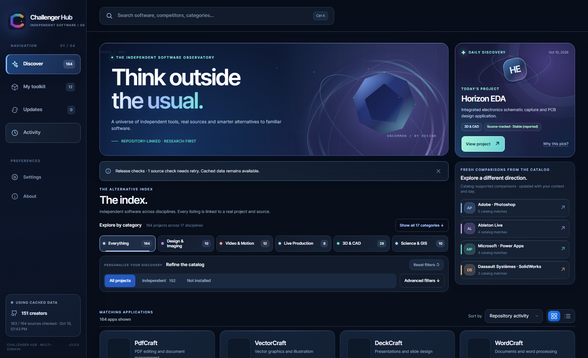
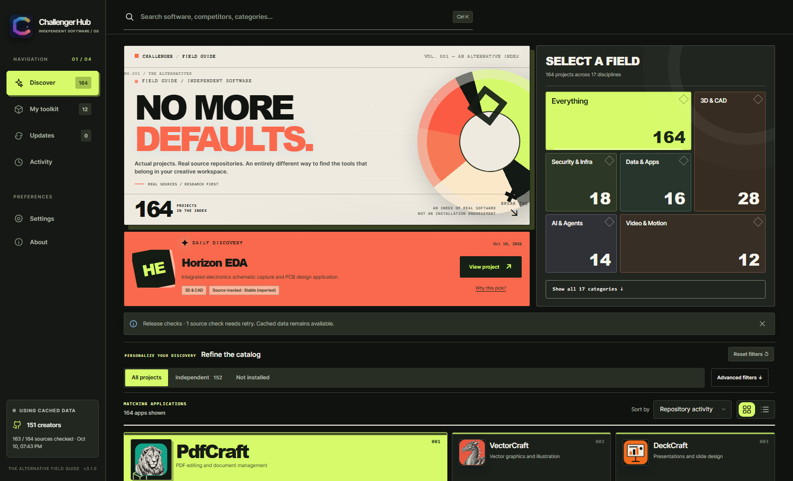
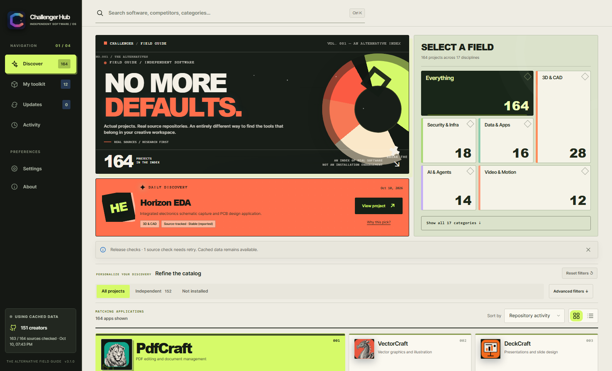
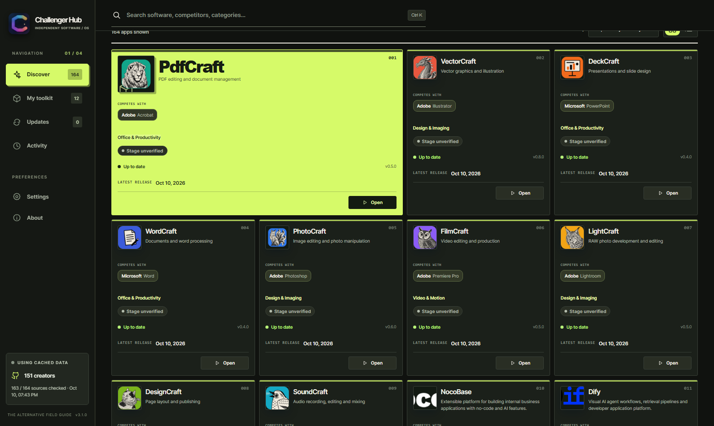
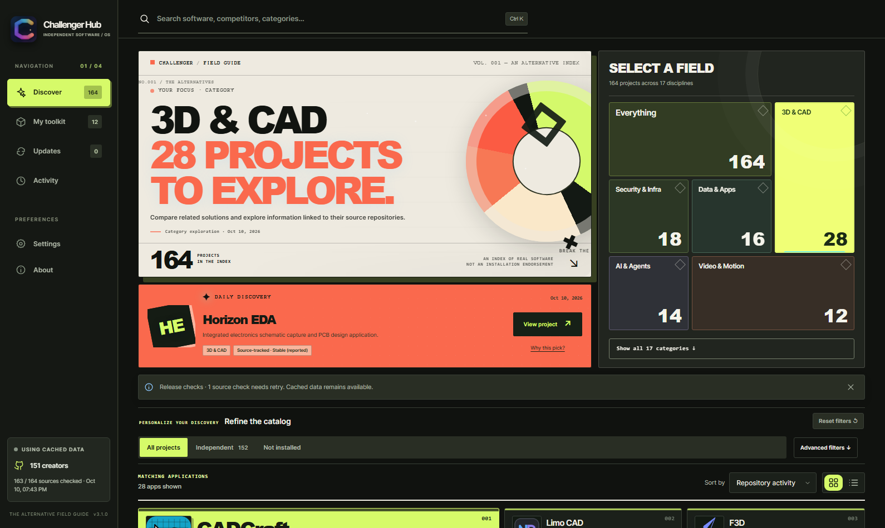
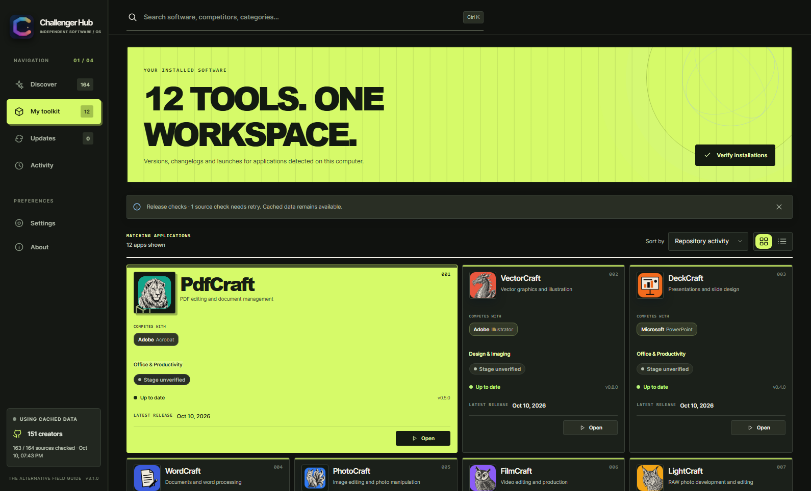
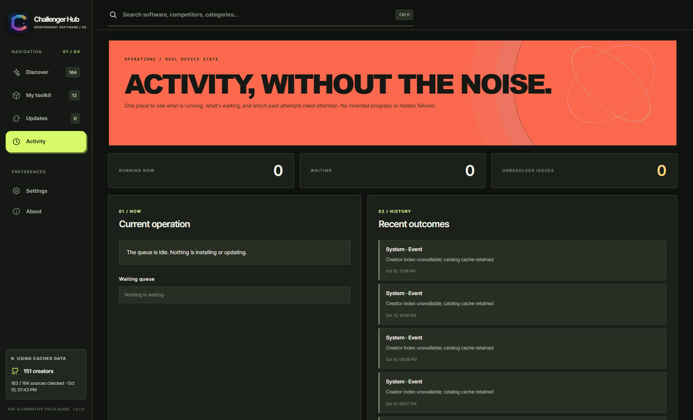
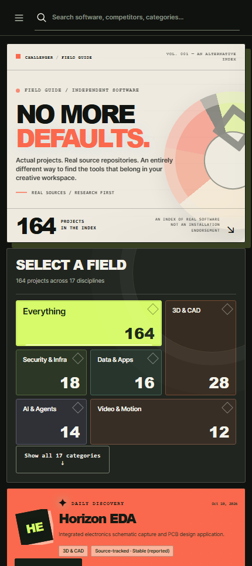

# Signal Field 3.1 — a second, radically different direction

**Candidate only · not released or merged.** Screenshots from live-data, read-only Chromium staging on the Windows Chris host, October 10, 2026. No software was installed, updated or launched as part of the capture. All counts reflect the local data as of capture time and can change.

## Contrast against Observatory 3.0

**Before — Observatory 3.0 (separate draft PR #8)**

**After — Signal Field 3.1 (new experimental direction)**

The change goes beyond colors: the primary entry is a typographic, print-inspired visual statement; the adjacent composition is *not* a decorative dashboard but a real sector filter, with counts derived from the loaded catalog. The index starts in the first desktop viewport, and the former redundant brand-shortcut area is no longer displayed.

## Same interface in a different light

## Actual working catalog, not a static render

The enlarged first result is a **visual feature**, not a quality rank or product recommendation. Every result retains its original real source, app status, safety restrictions, detail inspector and contextual action.

## One-click discovery

Choosing the **3D & CAD** field actually filters the index to the 28 matching projects on this device. Selecting **Show all 17 categories** reveals every discipline with its real current count. No extra shortcut controls repeat these destinations.

## Workspaces use the same design language

**My toolkit — your installed software and verification operation**

**Activity — sole destination for running, waiting and historical operations**

## Phone-sized experience

## Try the candidate without touching production

Open **http://127.0.0.1:17949/** from a browser running directly on Chris or MacMiniOffice.local (localhost resolves on each device independently). The preview server accepts **GET/HEAD only** and refuses all mutation requests. The baseline **3.0** preview remains at **http://127.0.0.1:17948/**. The untouched **production 2.7** remains at **http://127.0.0.1:17873/**.

**Decision gate:** Please review the *creative direction*, not minor padding or CSS polish. Is this distinct, memorable field-guide/art-book character right for Challenger Hub, or should the product identity move toward a different kind of premium software tool? No production rollout will occur without separate approval.
