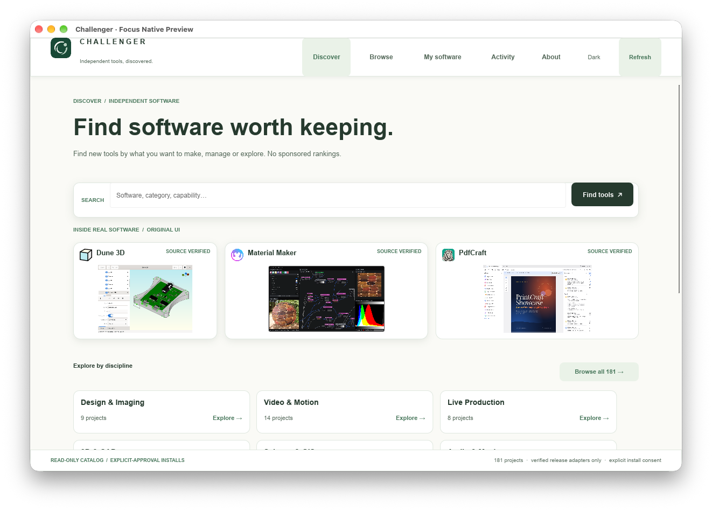
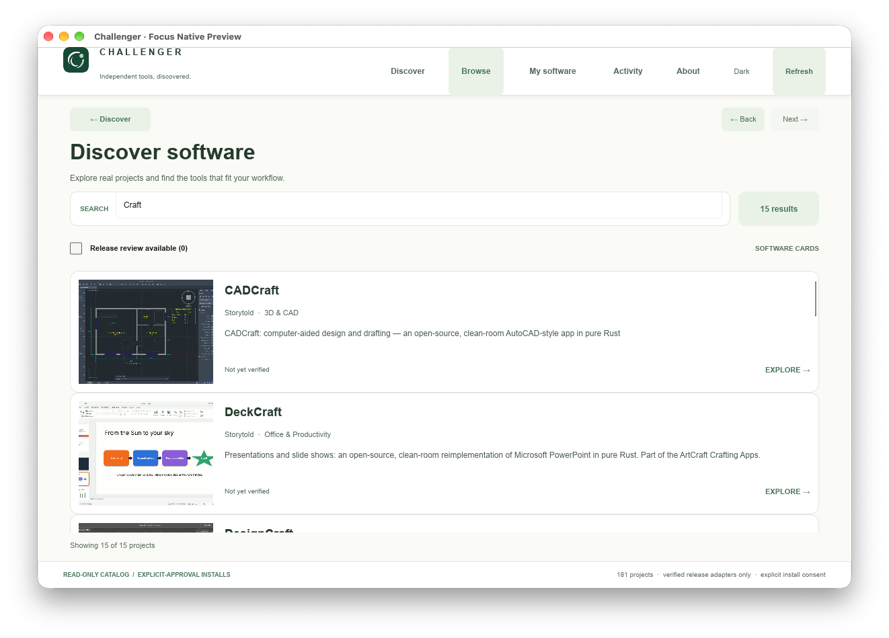
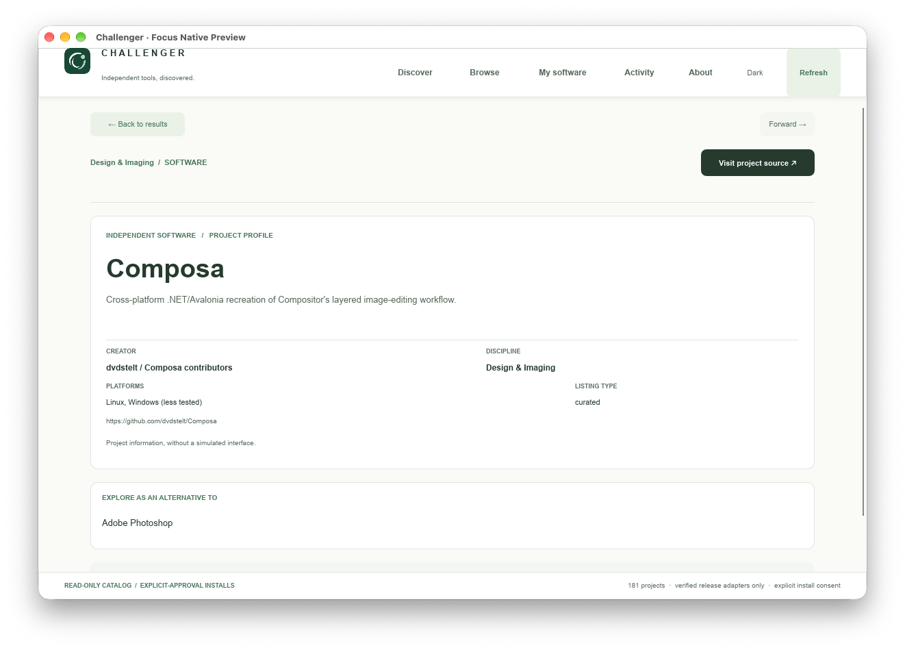
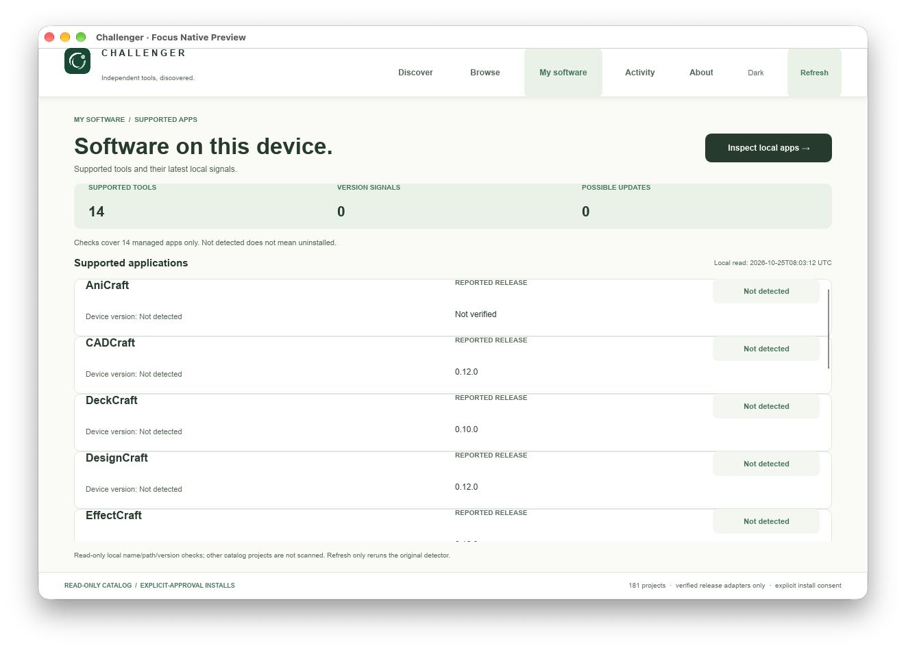

# Challenger Hub — product-first UX redesign

**Status:** implementation in isolated, dependent Draft branch. No product release or merge.

## Research reused from VelvetOS

On 20 October we reviewed 42 UI resources in the owner's original intake:
[comparative pilot](https://github.com/nocturney/velvetos-core/blob/main/docs/implementation/office-v2/phase2/ui-ecosystem-comparison-2026-10-20.md),
[original 42-source catalog](https://github.com/nocturney/velvetos-core/blob/main/docs/implementation/office-v2/phase2/ui-ecosystem-sources-2026-10-20.json),
and the [internal UX contract](https://github.com/nocturney/velvetos-core/blob/main/packages/vfbriefux/hq/UI-SYSTEM.md).

Selected references **only**, never copied assets or runtime dependencies:

- **Mobbin / Design Spells:** discovery flows, transition from collection to detail, primary task hierarchy.
- **21st.dev / shadcn/ui:** spacing, responsive product cards, search/filter patterns, source-owned component discipline.
- **UI Skills / XIAS:** anti-generic hierarchy review, focus/contrast/responsive/RTL gates. Objective checks must be validated, not blindly trusted.
- **Slint built-in FlexboxLayout and existing native controls:** actual implementation in Rust/Slint 1.18.1. No React, no paid API, no extra dependency.

## The structural issue

The former UI led with repository labels, review statuses, a tabular index, install
diagnostics and duplicate project facts. The user was effectively exploring the
catalog schema rather than software products.

## Implemented interaction model

1. **Discover** — primary search, original interface samples, grouped navigation
   by all 17 real source-backed disciplines. These are browse affordances, not
   invented "top picks" or ratings.
2. **Browse** — source-backed product cards by default with accessible keyboard navigation,
   source-backed project name/creator/discipline/summary, existing search,
   release-review-only filter, page size and show-more preserved. No monetized
   rankings or fake product art.
3. **App** — factual identity or authentic screenshot hero before diagnostics.
   Primary safe action visits upstream source. Release-review/install approval
   flow remains exactly as previously implemented, moved after the hero.
   Source/status/version evidence is accessible on demand, not a default
   report-like side panel.
4. **My Software** — each of 14 supported managed-app signals shown as a named
   software card; device and reported-source versions remain explicit. The
   separate opt-in OS registration read is preserved. "Not detected" never
   implies a known installation absence.

## Non-negotiable truth and safety rules

- Presentation modes: **Official media OR factual Identity** only.
- 70 verified original screenshots (29 projects), 30 source-verified icons;
  all remaining 152 projects show typographic identity, no simulation.
- Original source/sha/rights ledger and deliberately blocked public release are retained.
- Exactly 181 source projects; no fabricated app install state, ratings,
  reviews, capabilities, categories, recommendations or ranking claims.
- Native controls retain keyboard focus, accessible names, responsive widths,
  source host allowlist, read-only default, explicit per-release approval.
- Do not install services, merge PRs, change Preview11/Production or use paid APIs.

## Acceptance

Real native window screenshots at wide and 820px, keyboard product-card
interaction, native Rust smoke, Node install-policy tests, cross-platform CI
and explicit human product acceptance are required. A passing source test or
layout string search does **not** substitute for screenshot inspection.

The existing media/installer PR #30 remains the base. This redesign is its own
stacked Draft to allow independent review.

## Native grid performance gate (open)

A speculative 2-column Slint dynamic grid looped at 100% CPU during real Mac QA, despite successful compile and code QA. The unsafe grid and visible toggle were **removed**. The stable ListView now renders a substantial product card with a verified source image or factual identity and clear content hierarchy. No untested grid UI is exposed. Responsive two-column grid is deferred for a separate tested implementation. This PR is not claimed to provide a working grid/list toggle.

## Native Mac visual review, evidence

All images below are window-targeted captures of the real Rust/Slint UI with
Preview12's source-backed records, not illustrative mockups.

**QA finding and limitation:** The previous speculative two-column Grid/List toggle
was not accepted in native Slint QA due high initial CPU/start latency and
unstable window readiness under auto-closing QA routes. It is not in the
submitted implementation. The functioning Browse surface is a product-card
list with authentic product imagery/identity and improved task hierarchy.
A tested multi-column card grid remains a separate task, not a completed claim.
The My Software panel still reports only the 14 supported managed apps; a
reported version and a `Not detected` signal are never advertised as proof of
an installed or uninstalled system application.
