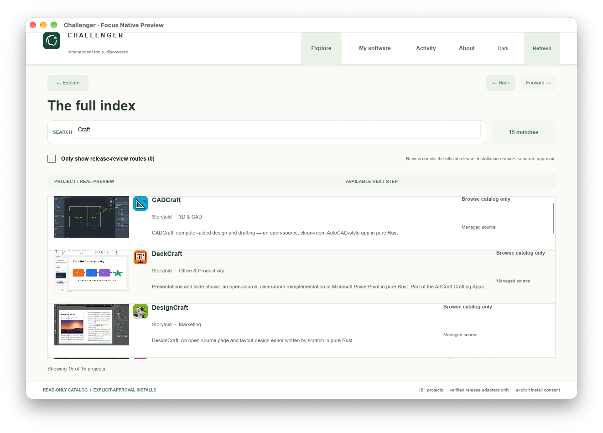
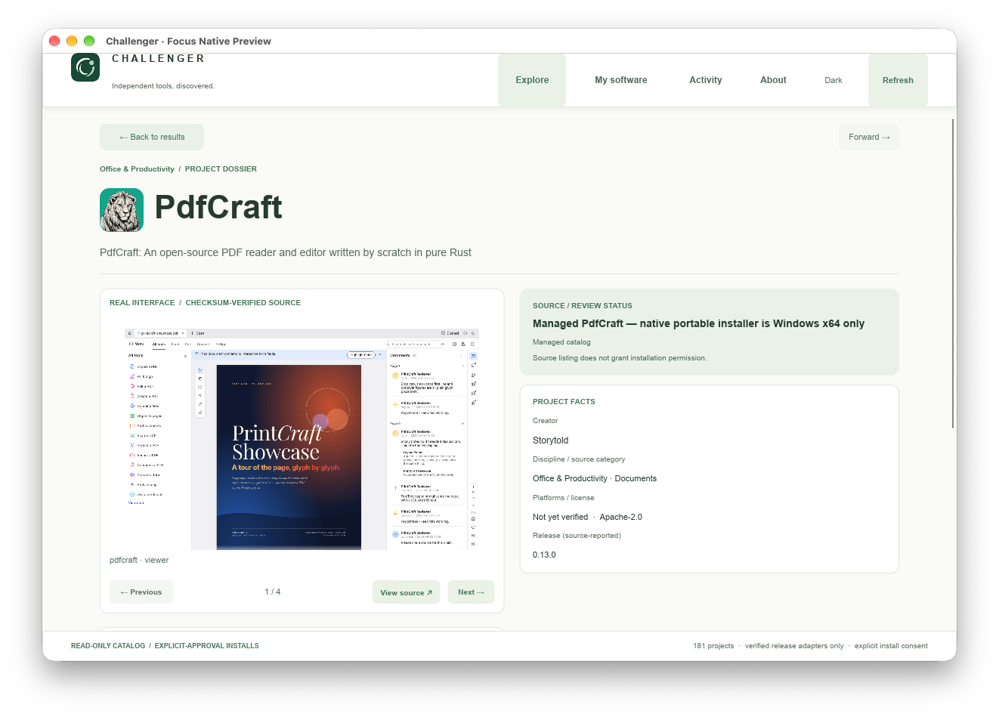
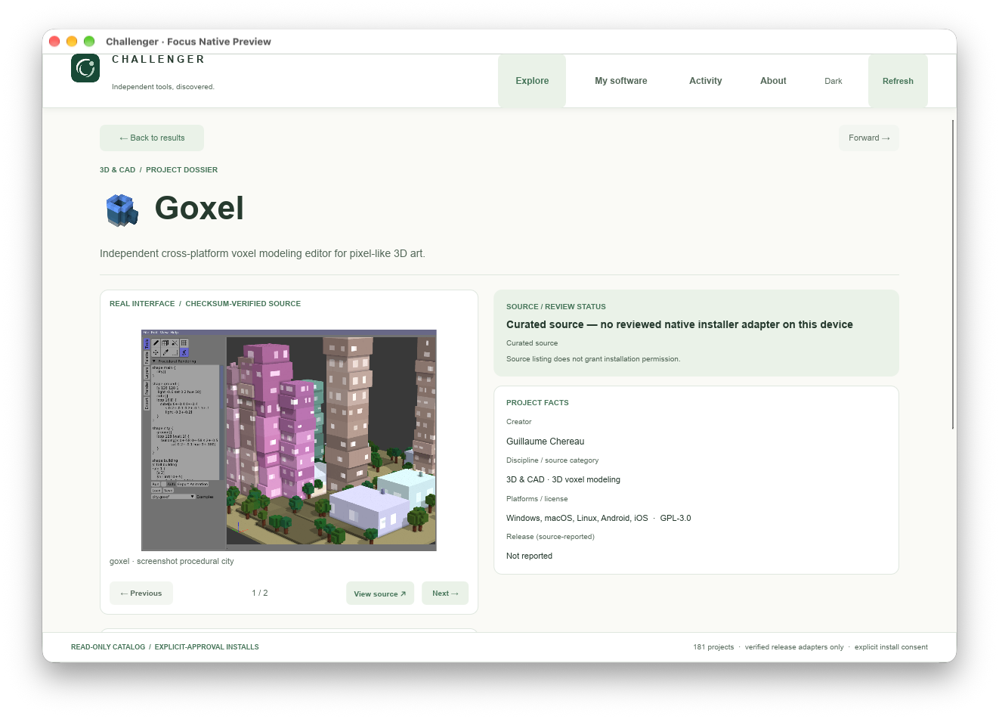
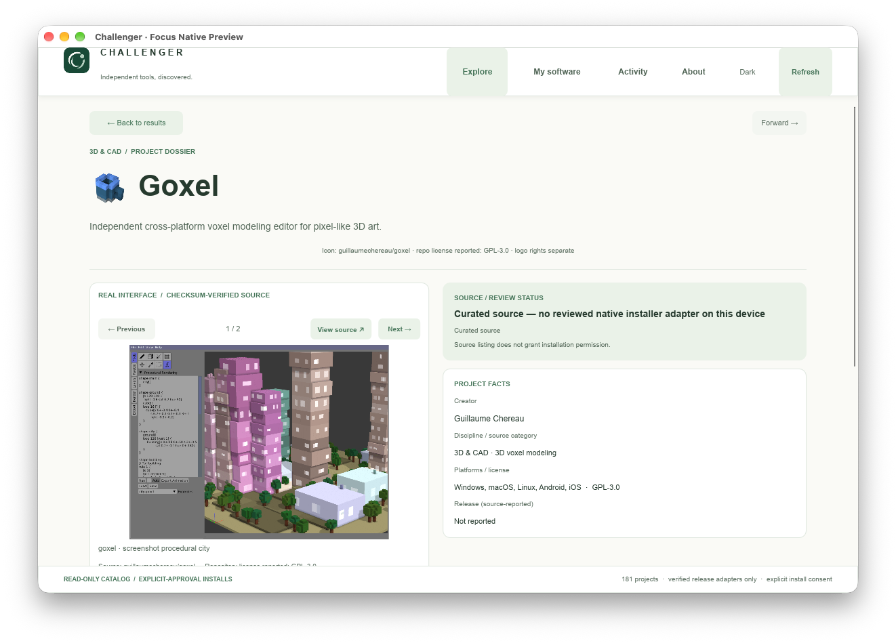

# Challenger Native — source-verified visual catalog, 25 Oct 2026

This is an incremental, **developer-preview** inventory based on a one-shot read
from the real Preview12 backend (181 projects), not a fabricated catalog.

| Metric | Native before | This change |
| --- | ---: | ---: |
| Native icons tied to exact project and official upstream | 22 | 30 |
| Projects with genuine embedded screenshots | 3 | 29 |
| Genuine embedded screenshot frames | 3 | 70 |
| Projects with no embedded screenshot | 178 | 152 |
| Projects with no embedded icon | 159 | 151 |

All 47 newly imported Craft UI screenshots were **already source-reviewed and
committed** under `tools/preview-build/media-source/assets/media/craft/`.
This change embeds their unmodified exact bytes in native Slint and validates
SHA-256 and byte counts, image dimensions, source URLs and license metadata.
The three previously approved curated screenshots are retained.

**Second source-locked wave:** 20 independently audited original screenshots
across 13 curated projects and eight original source icons across eight curated
projects (one icon-only). The additional 14 projects are all explicitly
`repository-confirmed` in `independent-media.v1.json`, have a reported repository
license and exact matching curated IDs and original GitHub URLs. We excluded
three entries marked `research-candidate-unverified` from this wave even though
their source file digests matched. Screenshot/image rights are not guaranteed
solely by the repository license and need review before external redistribution.
See `ui/INDEPENDENT_NATIVE_MEDIA_NOTICES.md` for per-image pinned source URLs,
commit, digest and reported license.

- `inventory-20261025.{json,csv}`: all 181 project IDs, source identity,
  category, logo/preview coverage, source-reported licenses, manifest links,
  screenshot SHA-256, screenshot count, imported bytes and exact UI integration.
- `missing-media-20261025.json`: actionable missing-media list, including one
  source-approved icon not yet embedded, with neutral fallbacks otherwise.
- `source-category-coverage-20261025.{csv,json}`: derived source-category
  gap counts for planning the next coverage wave, not a quality ranking.
- `ui/APPROVED_GALLERY_INDEX.json`: per-image original source link, license,
  image dimensions, caption and digest; generated from the approved manifests.
- `sync-approved-gallery.mjs --check`: offline CI gate for exact image bytes
  and generated Slint/Rust mappings; no hotlinks, downloads or AI imagery.
- `create-media-inventory.mjs --snapshot <validated-sidecar-json>`: rebuilds
  the inventory against a genuine 181-project read-only source snapshot.

Developer-preview UX now includes a third verified Explore card on wide windows,
preview thumbnails and summaries in Results, and a keyboard-accessible
multi-frame dossier gallery with source links for each reviewed screenshot.
An empty project remains clearly marked: no screenshot, not a counterfeit.

**Guardrails:** source catalog membership never implies permission to install;
no Production or Preview11 changes, automatic installation, user profile edits,
third-party installs or paid API calls. This alone does not authorize a stable
release or constitute full visual QA on every OS / screen size.

**Next coverage wave:** prioritize top Explore/Search entries and each of the
17 disciplines, then the remaining 152 projects without screenshots. New
assets must pass exact identity, source provenance, rights/attribution, SHA-256,
size/dimensions and genuine OS visual QA before inclusion.

## Real Mac Slint window QA, 25 Oct 2026

The following are **native window-targeted captures** from the running
Rust/Slint preview on MacMiniOffice2. No full-desktop/user windows, AI mockups
or browser captures were included. They show the real read-only Preview12
catalog, source-verified thumbnails and the four-frame PdfCraft gallery (first wave).

The Results screenshot follows the responsive column adjustment: the verified
image remains prominent and the tool/discipline source facts remain legible
at a normal Mac preview window width. This is visual evidence for Mac only;
interactive Windows/Linux layout still requires platform-specific acceptance.

## Second-wave native verification

This is a new window-targeted capture of the real Mac Rust/Slint preview with
Goxel's original source-pinned icon and screenshot, not a browser mockup. The
Goxel dossier shows a two-frame verified gallery and original source link.
The full 181-record sidecar remains real and read-only. On Mac, the expanded
Rust suite passed 36/36, Node bridge/installer-policy tests passed 16/16, native
GUI smoke verified 70 authentic screenshots / 29 source-pinned preview projects
and 30 icon identities, and actual native window resizing passed at 820/1180px.

Additional offline fail-closed checks intentionally injected (and fully
restored) a mismatched upstream repository, an unverified research-candidate
identity and a byte-tampered icon. All three were refused. Original 70-frame
media integrity then passed again. These local checks are not a substitute for
CI on the newest pushed commit or eventual public-distribution rights review.

The source-category gap inventory reports 16 engineering/manufacturing,
13 security/identity, 12 data/BI and 10 science/GIS records without verified
native screenshots. These are source-reported categories rather than the UI's
canonical 17-domain grouping; the counts are a coverage planning aid.

## Source credits, attribution and redistribution policy

The native UI now displays exact upstream repository attribution beside every
pinned screenshot and alongside every embedded official product icon. A
machine-readable, complete ledger of **100 images** is provided in
[`media-credits-20261025.json`](media-credits-20261025.json) and a readable
source-by-source credits file is available as
[`media-credits-20261025.md`](media-credits-20261025.md). The same credits files
are included in macOS and Windows portable developer packages.

**Giving credit is not the same as having permission.** Source-reported project
licenses are not automatically a license to redistribute screenshots,
third-party content or trademarks. This inventory separates byte-exact
provenance from copyright/trademark permission (the latter is not independently
verified). Credits must not imply upstream endorsement.

The offline `media-rights-gate.mjs developer` checks the ledger and exact pinned
source identities on every build; `media-rights-gate.mjs public` currently
fails deliberately until the distribution rights are independently verified.
This does not block ongoing internal development. For publication, obtain
specific grants or media licenses where required or omit those assets and use
honest placeholders; do not replace legal evidence with an arbitrary credit.
See the [Creative Commons BY 4.0 license](https://creativecommons.org/licenses/by/4.0/)
for an example where attribution plus its stipulated conditions is sufficient
for licensed copyright use. Neither a repository's existence nor a license name
alone proves that this CC BY permission applies to an image.

### Native attribution QA

The About screen exposes the media policy and explains the difference between
source credit and media rights. Each screenshot's caption now includes its
original source repository and the reported **repository** license; each
embedded icon is credited in its project dossier. For the other 152 entries,
Results uses a deliberately neutral **NO VERIFIED IMAGE** tile, rather than a
fabricated screenshot, and Detail retains the honest empty-media state.

The developer package writer compares the SHA-256 of the embedded
`MEDIA_CREDITS.md` and `MEDIA_CREDITS.json` against the approved generated
files before writing the artifact manifest. CI also checks that a simulated
public release is rejected until media-specific rights are reviewed.

After the attribution text increased the native dossier height, visual QA
revealed the gallery navigation could slip below a standard-height window.
Navigation controls now appear *above* the screenshot, so they remain
immediately accessible while the full source credit can still be reached by
scrolling. Window-targeted Mac capture, no screenshot reconstruction.
